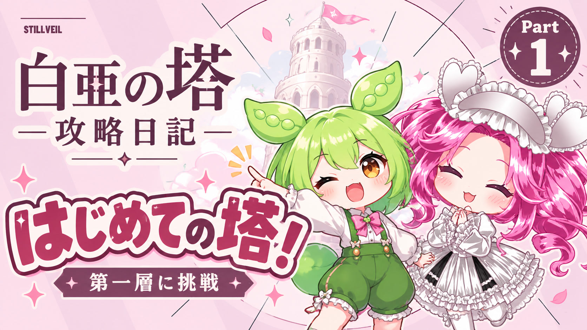
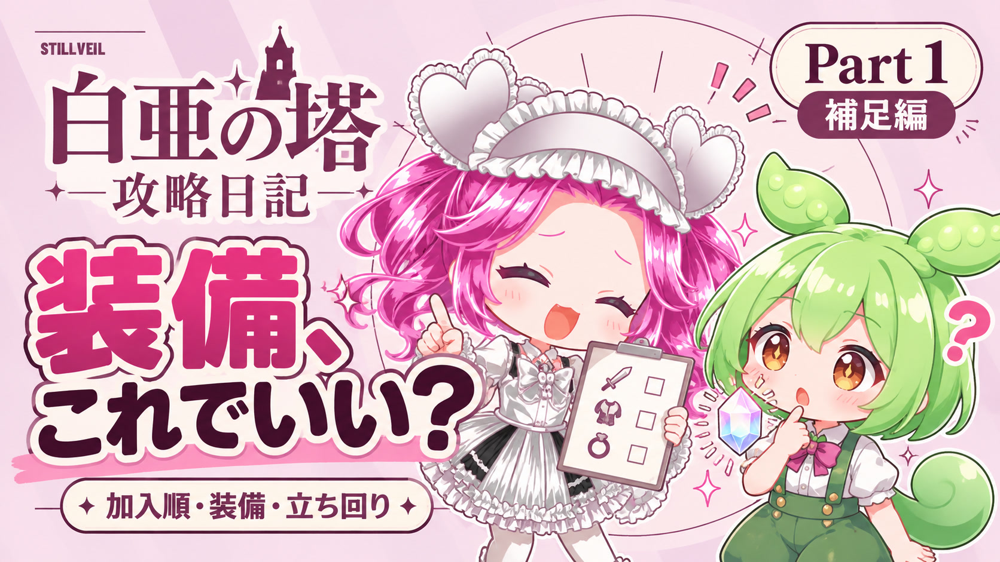
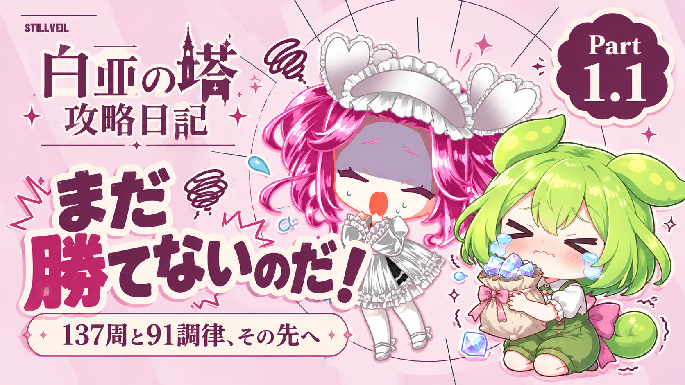
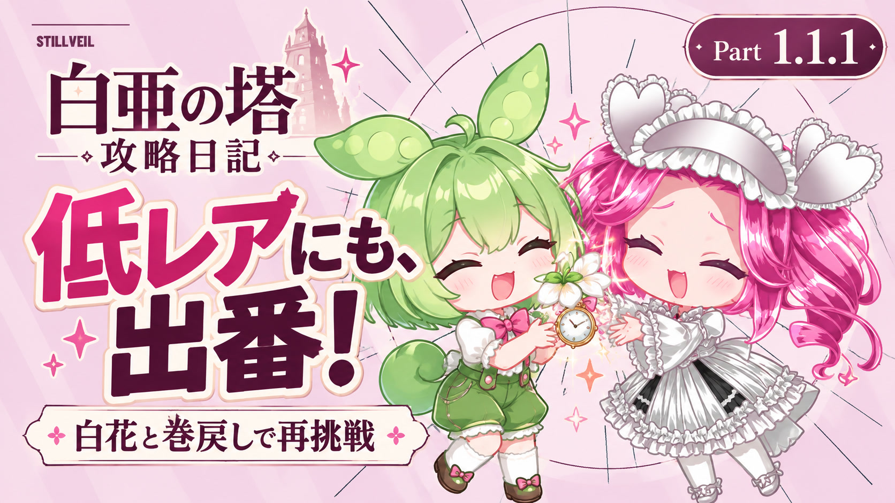
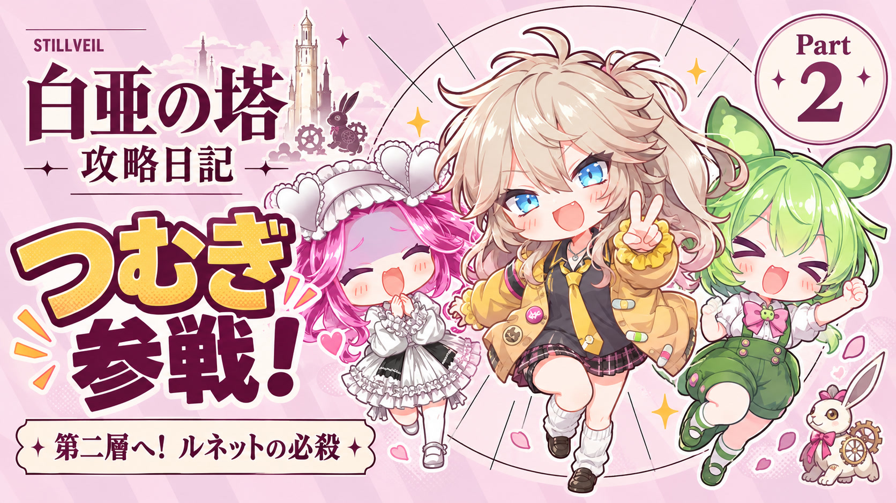

# 白亜の塔攻略日記 — 可愛いピンクのサムネイル集

ユーザー指定の共通OP内のピンクの場面を参考に、ちびキャラ・淡いストライプ・大きな見出しで5枚を制作しました。

[5枚をまとめてダウンロード（JPEG＋PNG）](https://github.com/ffuwa564-gif/Finit-battle-no-more/raw/refs/heads/downloads/tower-diary-thumbnails/TowerDiary-Cute-Thumbnails-All.zip)

YouTubeへのアップロードにはJPEG版がおすすめです。5枚とも2MB未満。PNGは生成時の原本で、Part2のPNGは2MBを超えるため、JPEGをご利用ください。画素数は1672×941（横長、約16:9）です。

## Part1 はじめての塔！

[ダウンロード JPEG](TowerDiary-Part1-Cute.jpg) ／ [原本 PNG](TowerDiary-Part1-Cute.png)

## Part1 補足編 装備、これでいい？

[ダウンロード JPEG](TowerDiary-Part1-Guide-Cute.jpg) ／ [原本 PNG](TowerDiary-Part1-Guide-Cute.png)

## Part1.1 まだ勝てないのだ！

[ダウンロード JPEG](TowerDiary-Part1-1-Cute.jpg) ／ [原本 PNG](TowerDiary-Part1-1-Cute.png)

## Part1.1.1 低レアにも、出番！

[ダウンロード JPEG](TowerDiary-Part1-1-1-Cute.jpg) ／ [原本 PNG](TowerDiary-Part1-1-1-Cute.png)

## Part2 つむぎ参戦！

[ダウンロード JPEG](TowerDiary-Part2-Cute.jpg) ／ [原本 PNG](TowerDiary-Part2-Cute.png)

## 制作について

image_genで制作した、キャラクターのちびイラストによるサムネイルです。JPEGは生成PNGと同じ画素数で保存形式のみ変換。表情や小物は回ごとの話題を表すイメージです。

ずんだもん・四国めたん：東北ずん子・ずんだもんプロジェクト
https://zunko.jp/guideline.html

春日部つむぎ：春日部つくし
https://tsumugi-official.studio.site/rule

参考：ユーザー指定のOP v4（017a0ccca241d1ec6a72b8a73f63188fc1043875）のピンクの場面。Part2のつむぎはVOICEVOX配布の話者ポートレートも参考。

Generation-Manifest.jsonに各回の生成指示とJPEGのSHA256を保存しています。
