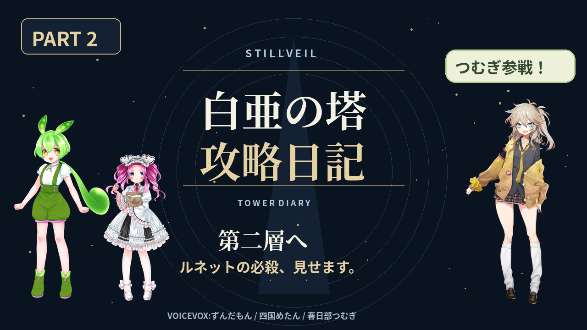

# 白亜の塔 攻略日記 Part2 — 第二層とルネットの必殺技

共通OP v4（23秒）を冒頭に収録。サムネイルもOPの星空・軌道線・金とアイボリーの文字に合わせています。

完成動画 **23:48 / 1920×1080 / 30fps / 48kHz**。
ずんだもん・四国めたん・春日部つむぎの三人で、第二層「旅立ちの残響」に挑戦します。Part1.1の敵調査→準備→試行→成功→振り返りの構成を参考に制作。

[動画をダウンロード](https://github.com/ffuwa564-gif/Finit-battle-no-more/raw/refs/heads/downloads/tower-diary-part2/STILLVEIL-TowerDiary-Part2.mp4) / [字幕](Subtitles-ja.srt) / [台本](Script.md) / [章一覧](Chapters.txt) / [サムネイル](Thumbnail.png)

[ゲームを無料で遊ぶ](https://fluffy3546.itch.io/stillveil)

## 内容

通常ルネットを迎えた最初の挑戦は40Rで時間切れ。覚醒に加え、ノクスを残してフィオと交代し、先頭への予約操作を見直して再挑戦。25R、薬3個、4人生存でクリアしました。妖精4回・戦場の花11回も利用しています。ルネットの必殺技は実機映像を再掲し、連射・着弾・最後の一撃にリアクションを合わせています。

開始データはPart1.1.1で明示した比較用の所持条件を継続したもので、新規プレイやPart1.1そのものの実終了セーブではありません。既存T4装備を引き継ぎ、今回の素材・加入・覚醒・T1巻戻し製作は通常のゲーム処理で実施。9戦の入力を再実行して結果一致を検証しました。最適編成・完全放置・アテナ依存解消・覚醒単独の効果を主張するものではありません。

## 同梱資料

- [開始条件・素材・音声同期の方法](Methods.md)
- [9戦のネイティブ再実行検証](Native-Verification.json)
- [配布完成動画の実フレーム・実SE・3話者の照合](Finished-Movie-Sync.json)
- [全体デコードとChromium/WebKit再生・シーク](Validation.json)
- [制作入力集](Production-Inputs.zip)：台本・制作コード・実戦証跡・音声FLAC
- [録画元](Recording-Sources.zip)：H.264＋可逆FLACのMKV、録画時刻・同期データ
- [動画説明文](YouTube-Description.txt)、[クレジット](Credits.md)、[元ゲーム版](Source-Version.txt)

## 再編集

制作ソース：[`video/tower-diary-part2`](https://github.com/ffuwa564-gif/Finit-battle-no-more/tree/video/tower-diary-part2)。そのリポジトリのルートへ2つのZIPを展開し、Node依存・Pythonのnumpy/Pillow/scipy・FFmpegを用意。VOICEVOX0.26.0をlocalhost:50021へ起動して`python scripts/diary-part2/bootstrap.py`を実行すると、公式立ち絵の取得と音声・録画元の可逆復元を行えます。その後`python scripts/diary-part2/render.py`、`python scripts/diary-part2/audit.py`、`node scripts/diary-part2/validate.mjs`で再制作・照合できます。ブラウザ検査用にViteをport4328で起動してください。立ち絵や楽曲の単体再配布は含みません。各権利元の利用規約はCredits.mdを確認してください。
