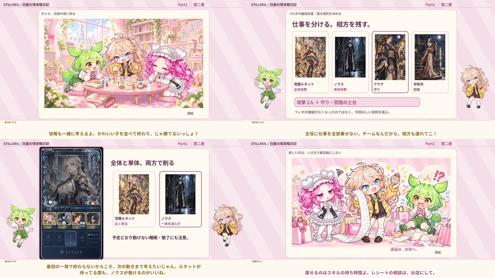

# 白亜の塔攻略日記 Part2 改良版

**19分19秒・1080p30・日本語／ずんだもん／四国めたん／春日部つむぎ**

[▶ 改良版をダウンロード](https://raw.githubusercontent.com/ffuwa564-gif/Finit-battle-no-more/refs/heads/downloads/tower-diary-part2-v2/STILLVEIL-TowerDiary-Part2-v2.mp4) ｜ [サムネイル](https://raw.githubusercontent.com/ffuwa564-gif/Finit-battle-no-more/refs/heads/downloads/tower-diary-part2-v2/Thumbnail.jpg)

可愛いピンクの本編、会話ごとの表情、編成・敵役割・素材・実戦HPの図解、作戦会議とお買い物の挿絵。OP直後に失敗ダイジェストを入れ、重複説明を整理しました。元の第二層実戦を再編集した版で、ゲーム本体と戦闘結果は変えていません。

[字幕](Subtitles-ja.srt)／[チャプター](Chapters.txt)／[台本](Script.md)／[YouTube説明文](YouTube-Description.txt)／[制作素材ZIP](Production-Inputs.zip)／[録画素材](Recording-Sources.txt)／[制作コード](https://github.com/ffuwa564-gif/Finit-battle-no-more/tree/d9c3410e70ae5940f39d1cc3692597abbd810583/scripts/diary-part2-v2)

[開始条件・検証](Methods.md)／[クレジット](Credits.md)／[参照した動画と調査範囲](Research.md)。外部YouTube本編は接続制限で視聴できず、公開情報と実際に確認できたPart1.1のレイアウトを区別しています。

配布MP4自体の映像・実SE・全3話者、必殺着弾同期を照合。全体デコードとChromium/WebKitの開始・中間・終了再生／シークを確認。頭の安全域・字幕2行・話者の表情切替も検査。各JSONは完成SHA256に紐づきます。

完成SHA256: `7e100076b74c510752c40209c343cbb9f2172f62dc3628c2269ac91d1b9aba1e`
