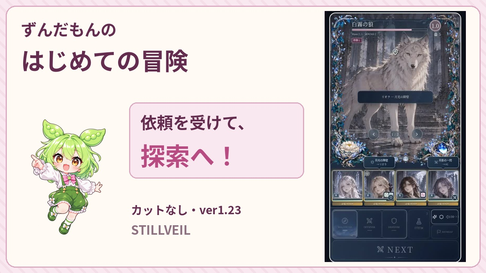

# ずんだもん、依頼を受けて冒険へ

[動画MP4を開く・保存する](https://raw.githubusercontent.com/ffuwa564-gif/Finit-battle-no-more/media-story-uncut-v123-20261106/Stillveil-Zundamon-v123.mp4) ／ [動画・字幕・説明文をZIPでまとめて保存する](https://github.com/ffuwa564-gif/Finit-battle-no-more/archive/refs/tags/video-story-uncut-v123-20261106.zip)

**STILLVEIL ver1.23・13分6秒。** 序盤を組み替えた最新版を、新規セーブから撮り直しました。最初の依頼から聖堂・参道・鐘楼の3探索を回り、帰還報告と最初の工房設備まで進めます。

カットなし。収録した全区間を順方向に一度ずつ使用しています。会話・戦闘は等速、移動・製作の待ち時間だけ2倍速です。通常UIへの自動入力によるプレイに、VOICEVOXの後付け実況を重ねています。能力・所持品・進行・乱数・ゲームの時計は変更していません。

1920×1080 / 30fps / H.264・AAC / 48kHz。音声56台詞、ゲーム音28点、映像28点、元録画の戦闘9点の照合、全編デコード、ChromiumとWebKitの再生・シーク検査に合格した同一MP4です。

動画SHA-256: `d1710e3f338e4f4906f9c1008c1505ea3efee7ead5442f8a1474c2a9fad1c2bc`

YouTubeへの投稿は行っていません。投稿時は [YouTube-Description.txt](YouTube-Description.txt) のクレジットを掲載してください。字幕・チャプター・台本・品質報告も同梱しています。旧1.22動画とゲームの公開ブランチは変更していません。

音声：VOICEVOX:ずんだもん（ノーマル） https://voicevox.hiroshiba.jp/  
キャラクター：ずんだもん（東北ずん子・ずんだもんプロジェクト） https://zunko.jp/  
音楽：甘茶の音楽工房（作曲：甘茶） https://amachamusic.chagasi.com/

ゲーム：https://finit-battle-no-more.luxpedia.workers.dev/
