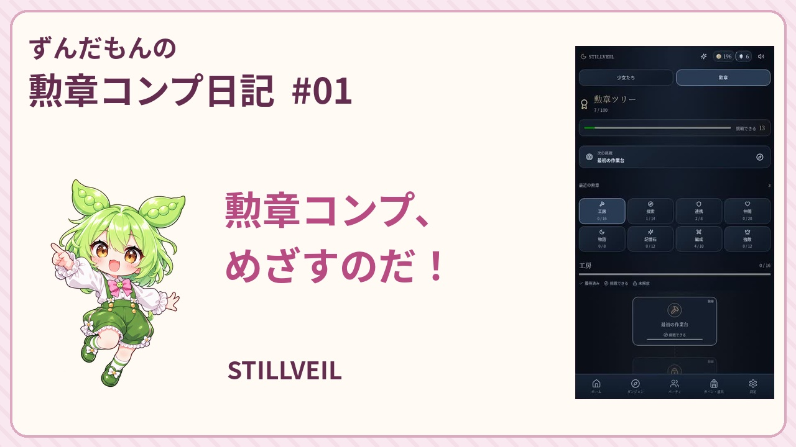

# #01 【STILLVEIL】 勲章コンプ、めざすのだ

ずんだもんの勲章コンプ日記。8分17秒 / 1920×1080 / 字幕入り。

[▶ 動画を開く・保存する](https://raw.githubusercontent.com/ffuwa564-gif/Finit-battle-no-more/media/medal-diary-01-20261106/stillveil-medal-diary-01.mp4)

[投稿用セットをダウンロード](https://raw.githubusercontent.com/ffuwa564-gif/Finit-battle-no-more/media/medal-diary-01-20261106/YouTube-Package.zip) — MP4、字幕、サムネイル、台本、説明文、チャプター、クレジット、検証記録。

[制作記録](https://raw.githubusercontent.com/ffuwa564-gif/Finit-battle-no-more/media/medal-diary-01-20261106/Production-Inputs.zip) / [検証結果](final-qa.json)

新規データの通常UIを自動操作して収録し、ずんだもん実況を後付け。移動待ちのみ倍速、カットなし。能力値・所持品・進行・ゲーム内時計の変更なし。ver1.28.0の収録用ソースを使用。今回は2か所を踏破、勲章7/100個。

VOICEVOX:ずんだもん / 東北ずん子・ずんだもんプロジェクト / 音楽：甘茶の音楽工房。投稿時は [説明文](youtube-description.txt) のクレジットを掲載してください。

完成MP4 SHA-256：`ada3e797746995adafe029513728a4aac98cc8d500edfc6a3f3b677eedbe8b7f`

ゲーム本体の更新・YouTubeへの投稿は行っていません。旧作を上書きしない独立したメディアブランチです。
