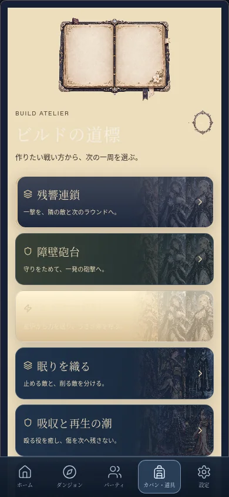
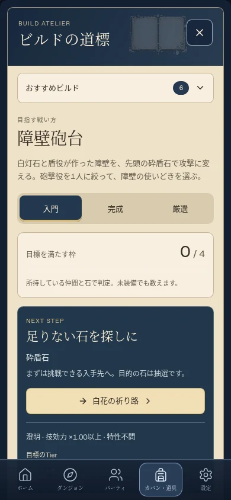

# ビルド手帳の再構成

ビルドの一覧と説明が画面を占め、現在の進捗と次に押すボタンが埋もれていた。さらに、紙面の上に古い白文字が残り、選択やホバーで背景だけが明るくなる場合があった。

画面を次の順に並べ直した。

1. 小さな見出しと、初期折りたたみのおすすめビルド一覧。
2. 選択中のビルド、その戦い方、入門・完成・厳選の切り替え。
3. 所持品から判定した達成数と、次にできる行動。
4. 目標の追跡、編成候補、変更内容の確認。
5. 必要なときに開く実演、装備詳細、入手先、相性、使い方。

候補を選ぶと一覧を閉じて詳細へ移動する。完成済みの編成では確認ボタンを重複させず、変更を確定する前の確認と取消は維持する。部分的に揃った編成の適用も従来どおり可能。段階・目標の保存、Tierごとの入手先、購入・装備・戦闘処理は変えない。

紙面は濃い文字、次の行動は紺地に明るい文字とし、ボタンは読みやすい単純な枠へ変更。生成済みの本は見出しの小さな装飾に使い、大きな空白の本や、各区画の空の挿絵を取り除いた。`InventoryTheme.controls` の型付き指定で、ビルド手帳のボタンだけをこの表現にする。スタイルは `build-planner.css` に集約し、他のテーマファイルにあったビルド用の上書きを撤去した。

旅の記録・装備実験・周回実績・調律の手段・欠片の数値にも紙面の配色を適用。欠片は幅に応じて列を減らし、クラフトのレシピはアイコン・見出し・必要素材・操作を別の行へ整理する。

## 検証

- 320/390/1024px、日本語と英語で、次の行動が編成候補より先に見えること、横方向にはみ出さないことを確認。
- 通常・選択中・ホバー時の主要な本文とラベルについて、実際のCSS色からコントラスト比4.5以上を検査。生成画像の模様上すべてのピクセルを保証する試験ではないため、画面の目視確認も併用。
- 空の所持品、目標保存、低品質の代替装備、上位Tier不足、装備移動の確認と取消、完成済みの編成適用、石の製作、入手先への遷移、実演中の保存データの不変性を実操作で確認。
- 操作音の単一所有、クラフトの生産、ネイティブ長押し保護と入力欄の編集を回帰検証。

## 実画面

隔離した検証セーブを使用。公開セーブは変更していない。

| 変更前 | 変更後 |
| --- | --- |
|  |  |

[ビルド一覧](images/build-notebook/catalog-390.webp) / [完成済みの編成確認](images/build-notebook/confirmation-390.webp) / [旅の記録](images/build-notebook/journal-390.webp)
