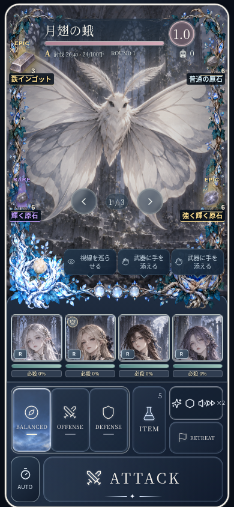
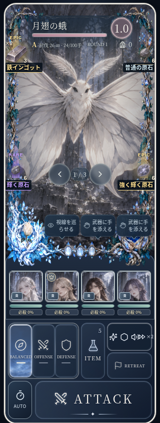

# 連続討伐と回収 — 実装・厳しいレビュー

## 実装した遊び

通常ダンジョンの準備画面から新しく出発すると、味方の行動を上限100手とする連続討伐に入る。Bランクからは任意にボスへ進める（追加仕様は [遠征用品](expedition-supplies.md) を参照）。生存する敵は前半3体、50手以降4体。倒した敵は同じラウンド中に補充される。敵の選択は既存のページ送りと、そのページを対象にするコマンド入力を使う。100手の後は残存雑魚を退場させ、元の最終編成でボス戦を行う。退場した敵には討伐数・報酬を付けない。

1手は味方1人の行動。攻撃、回復、防御、必殺、状態異常での行動不能も消費する。援護攻撃も1手消費し、ドロップ→援護→ドロップを無限に循環させない。ラウンド解決と演出再生を分離した既存方式を保ち、画面には演出位置に対応した討伐数を出す。

敵の遭遇補正、後半の圧力、エリート、ランク表、地域別の部材候補は `src/domain/hunt.ts` にまとめた。元のキャラ定義・仲間になった時の能力は書き換えない。出現中の個体に遭遇補正を適用する。塔・イベント・腕試し・研究シナリオ・ボスを持たない場所は対象外。出発済みの旧探索は旧形式のまま再開できる。

## ランクと本物の報酬差

|ランク|討伐数|原石の出現枠率|素材枠でRARE / EPICになる率|石の追加T4 / T5抽選率|
|---|---:|---:|---:|---:|
|C|0|10%|4% / 1%|2% / 0%|
|B|12|13%|8% / 2%|6% / 1%|
|A|24|17%|13% / 4%|12% / 2.5%|
|S|40|22%|19% / 7%|22% / 6%|
|SS|60|27%|25% / 10%|30% / 10%|

上の率は抽選枠が空いている敵撃破時の値。素材枠自体は54%。石は当該ダンジョン本来の上位Tier率も引き継ぐ。Tierは石の各ロール値に適用され、全ての石が高Tierになる保証ではない。到達したランクは以降のドロップに作用し、既に出た物の中身を後から書き換えない。

RARE / EPICの素材は実際にクラフトへ使える中間部材。採掘・釣り・伐採系統、章ごとに候補を分け、準備画面に狙える部材を載せる。RAREは基本1個、EPICは基本3個に収穫強化を加算し、1塊最大5個。初期の地域で同じ部材が出ても色だけの格上げにしない。

枠に出た時点で部材名・原石の期待値名、RARE / EPIC表示、紫・金の光柱、強調音を出す。原石の色と音は普通／輝く／強く輝くという期待値を表し、封印された実Tierを漏らさない。輝く石を確定Tierのように見せない。

回収物は撃破に結び付け、演出を増やすだけ・回復だけでは稼げない。通常資源と希少部材は別枠で各120、原石は1探索64を上限とする。通常資源を先に拾っても希少部材の枠を潰さない。実際に表示した個数を受け取れるよう、出現中の分も予約する。戦利品は獲得確定まで仮取得。失敗時には持ち帰れない。討伐の記録と回収した原石数を既存の周回履歴にも保存する。

## ハクスラ好きの目線での指摘と対応

### 今回、修正した欠点

1. **触る物を増やしただけではハクスラにならない。** 敵の補充、100手の効率勝負、ランクに連動した実際の部材・石の抽選をつないだ。
2. **光るだけで中身が同じなら、すぐ信用を失う。** EPICは数量も上げ、高いランクでは封印された石の実ロール分布も改善する。表示は実際の期待値から作る。
3. **最初の通常品で後半のレア品が出なくなるのは罰ゲーム。** 石の旧3個上限を連続討伐では64にし、通常資源と部材の容量を分離した。後半ほど価値が上がる仕組みと逆行する上限を直した。
4. **エフェクトの多いビルドほど三択が出るのは、強化へのペナルティ。** 三択の新規出現は演出数ではなく味方の行動数に合わせ、最初の2手と以降24手間隔にした。既存の三択を保ったまま、戦場を頻繁に塞がない。
5. **一掃するほど素材飛翔を一個ずつ待つのは爽快感を殺す。** 雑魚の素材イベントは180/280msで進め、980msの飛翔は別の寿命で重ねる。飛翔演出を途中で消す対処ではなく、並行再生する。雑魚素材の説明トーストも連打しない。
6. **倒した敵へのピンや状態異常の付与者が消えると、周回どころではない。** 撃破済み対象へのピンを解除し、残る状態異常が参照する死亡個体だけは保存上保持する。保持した死体をページ送りの常設候補にはしない。
7. **どこでも同じ部材なら、一番楽な所しか回らなくなる。** 系統・章別の部材候補と既存の石の系統・深度差を維持し、準備画面に実候補を表示した。

### 数字で確認したこと

忘却の聖堂、同じ5シード（42 / 123 / 504 / 1024 / 8801）で確認した。基礎能力・敵・持ち物の数値を書き換えないドメイン検証。回収は取り切る自動入力で、援護・薬・必殺の任意予約は使わない。人間が全てのドロップを拾えるという意味ではない。

|編成・条件|討伐数|ランク|
|---|---:|---|
|初期4人・標準作戦|28〜30|A|
|同じ4人・攻撃作戦|25〜30|A|
|同じ4人・生存作戦|27〜29|A|
|同じ4人・既存の灯芯の補助石を各1個|44〜48|S|
|所持制約を外した検証用SSR編成|41〜50|S|

初期4人でも既存のクラフト可能な石でSへ伸ばせる。「SSRへ入れ替えない限り効率が上がらない」構造ではない。一方、作戦ボタンだけではランクが変わらなかった。操作の上手さや判断の幅が十分になったとは言わない。

実装テストでは、同じ抽選条件でCとSSを各400シード×12回比較し、希少部材数・石の平均威力ロール・石数が増えることも確認する。セーブ再開、100手境界、援護の無限循環防止、敗北時喪失、二重確定防止、実画面のページ選択、320/390pxの表示、登場時の音、飛翔の並行再生を別々に検査する。

### 初回実装時の弱点 — 追加改修前の評価

- **100手固定には、周回時間の下限がある。** 装備で討伐効率は上がるが、圧倒的に強くなってもすぐ終わるDiabloの高速周回とは違う。ランクや収穫が変わっても同じ長さの反復が続くと飽きる。次の評価では実時間当たりの希少品数と、途中の退屈を見たい。
- **「灯芯を全員に」が唯一の正解になる危険。** 今回は初期編成の選択肢が効くことを確認した段階。別の石や連携でも同程度の成果を出せるか、道中とボスの両方で比較する余地がある。新しいユニーク石や大規模なキャラ調整は今回していない。
- **石が増えると、研磨と比較の手間も増える。** 原石を拾った喜びが、帰還後の作業量に変わる恐れがある。スキルを一つ増やす核と、磨くまでTierを伏せる仕様は保った。まとめて整理する導線は別途必要。
- **希少部材はクラフト短縮が主な価値。** 工房が完成した後まで欲しくなる消費先は、今回増やしていない。色と音だけを強くしても、最終的な使い道が薄ければ飽きる。

結論：効率を伸ばして価値の違う物を拾う仕組みは成立した。ただし、中毒性や長期周回の面白さまで実証したとは扱わない。今回の評価はコード・シミュレーション・UI検証によるもの。プレイヤーの継続率を測った評価ではない。

上記の固定時間・研磨負担・素材消費先には、追加の [遠征用品・早期ボス移行](expedition-supplies.md) で対応した。以下の表示例と初回の計測値は改修前の記録を残している。

## 表示の確認例

以下はレア度差を同時に確認するためのテストfixture。実プレイでこの4品が同時に落ちた結果ではない。

## 検証結果

- `npm test`: 117ファイル、953テスト成功。
- `npm run build`: 型・コンテンツ・UI契約・英語メッセージのゲートとビルド成功。
- `e2e/hunt.spec.ts`: Chromium / WebKitで各4件成功。表示、ページ選択、重なる素材飛翔と登場時の音、通常の準備画面からの出発を確認。
- 既存の回収4件、加速3件、操作音の所有権3件のブラウザ回帰も成功。
- 全探索を保存コマンド経由で進め、各演出の保存データを検証する統合テストを含む。
- 生データは `hunt-balance.json`、再計測は `npx tsx scripts/audit-hunt.ts`。
