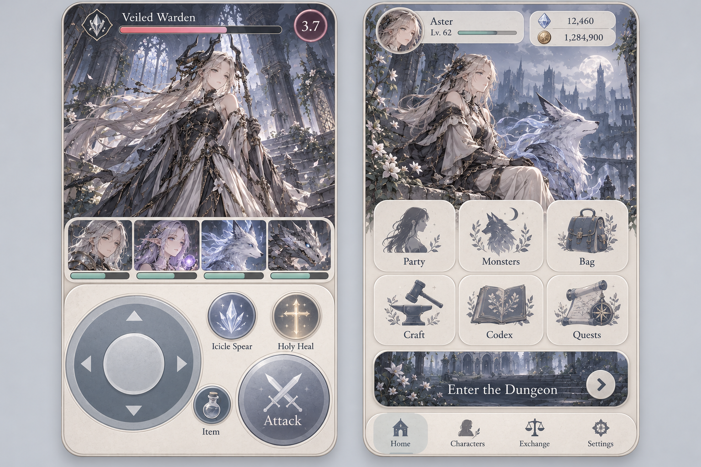

# ゲーム設計書

- 更新日：2026-10-24
- 状態：初期実装仕様。ブラウザーで遊べる試作0.1.0を構築中。数値はプレイ検証後に調整する。
- タイトル：未定
- 初期対応：静的Webアプリ。Cloudflare Pagesでの配信を初期設計の選択とする。接続・公開はユーザー担当。
- 本書を仕様の正本とする。同じ規則を複数箇所で再定義しない。
- 「初期仕様」は、ユーザーから対応策の具体化を任された範囲で決めた実装用の規則。以前の未決定記述に優先する。

## 1. コンセプトと初期実装範囲

美麗イラストを特徴とする、静謐で少し退廃的なダンジョン探索RPG。
スタミナなしでWave制ダンジョンを周回し、敵が落とす素材を集め、敵を仲間にして編成を広げる。

- 人型・亜人は、敵・仲間・その他の登場人物を含めて女性のみ。
- 非人型モンスターも登場する。
- 敵と仲間は共通のキャラクター・スキル定義を使用する。
- プレイヤーは作戦指示と道具使用を行い、各キャラは1ラウンドに1回、素早さ順に行動する。
- 初期実装ではレベル、装備、スキル強化、複合役割を導入しない。収集と編成、道具、作戦で攻略する。
- 最初の検証用コンテンツは味方4体、通常敵6種、3Waveのダンジョン1つ。最終Waveには通常種を補正したボス1体のみを配置する。ガチャはその後に接続する。

## 2. 基本の進行

1. パーティを編成し、道具を確認する。
2. ダンジョン選択画面で敵傾向・算定難易度・素材の入手先を確認する。
3. 複数の敵が出るWaveを攻略し、全滅させると次へ進む。
4. 最終Waveの敵をすべて倒し、報酬確認画面で獲得を確定する。各ダンジョンの初踏破で石を1個獲得する。
5. 持ち帰った素材で敵を仲間にし、編成を変えて次の探索に挑む。

敵の仲間化は戦闘中の捕獲操作ではなく、探索後の素材交換として行う。

## 3. キャラクター・強さ・スキル

### 3.1 定数と計算の方向

キャラクターの難易度定数を強さ乗数として使う。
計算は「定数を設定 → 能力値とスキルを決定 → 編成からダンジョン難易度を算定」の一方向とする。
能力値から同じキャラの定数を再計算しない。定数は強さの設計基準であり、勝率や厳密な戦力比を保証する値ではない。

- 内部では整数の強さ単位を持つ。10単位を定数1.0とし、1単位が0.1に対応する。
- 初期コンテンツのキャラ定数は1.0～3.0。0以下は無効。
- 表示は小数第1位。二進浮動小数の誤差で0.1刻み判定をしない。
- 探索へ出発するたび、リーダー効果を適用した最大HPまで全員回復し、戦闘不能・状態効果・再使用待ちをすべて解除する。
- HP、戦闘不能、強化・弱体化、かばう、再使用待ちは探索内だけの状態。成功・全滅・撤退のいずれでも、退出後の恒久キャラデータへ持ち越さない。
- 基本能力は最大HP、攻撃力、防御力、素早さ。初期実装では物理・魔法の別能力を作らない。
- HP・攻撃・防御に定数をそのまま掛け、小数点以下を四捨五入する。素早さは役割基準値のまま。
- 戦闘中の強化・弱体化を適用した有効能力値も四捨五入して整数化し、以降のダメージ・回復式へ渡す。基礎定数・ボス補正・リーダー効果の各段階の四捨五入と順序は各節の規則に従う。
- 倍率・スキル係数は整数比または固定小数で保持し、表示用に丸めた数値を計算へ戻さない。四捨五入は非負値の0.5切り上げとする。
- ダメージは max(1, floor(攻撃力 × スキル威力係数 − 対象防御力 × 0.5))。
- 回復は max(1, floor(使用者攻撃力 × 回復係数)) とし、最大HPを超えない。
- 初期実装では命中失敗、クリティカル、属性耐性、継続ダメージは導入しない。

### 3.2 役割テンプレート

以下の数値は定数1.0の基準値。生成時は既存の役割IDを必ず指定する。

| 役割ID | 役割 | HP | 攻撃 | 防御 | 素早さ | 責務・必須機能 |
| --- | --- | ---: | ---: | ---: | ---: | --- |
| healer | ヒーラー | 100 | 25 | 14 | 12 | 単体回復を最低1つ |
| tank | タンク | 160 | 18 | 26 | 18 | かばうを最低1つ |
| attacker | 単体アタッカー | 100 | 32 | 12 | 14 | 単体攻撃を最低1つ |
| area_attacker | 範囲アタッカー | 90 | 28 | 10 | 11 | 全体攻撃を最低1つ |
| supporter | サポーター | 110 | 22 | 16 | 13 | 味方強化を最低1つ |
| debuffer | デバッファー | 100 | 24 | 12 | 15 | 敵弱体化を最低1つ |

役割は行動選択の設定データであり、キャラ別の専用戦闘コードを作らない。
roleId、能力基準、必要なスキル機能、条件付き行動優先順位、使用不能時の通常攻撃を共通契約で管理する。

### 3.3 敵・仲間・ボスの能力

- 同じ定義・同じ条件なら、敵時と仲間時の基本能力・搭載スキルは一致する。
- ボスは同じ定義の戦闘個体に、HP3倍・攻撃1.2倍・防御1倍・素早さ1倍を適用する。
- 通常の定数適用後にボス補正を適用し、各段階で四捨五入する。
- ボスも1ラウンド1回行動。専用の追加行動は持たせない。
- ボスとして出た種も仲間化可能。ただし仲間化するのは通常個体で、ボス補正は持ち越さない。交換画面に通常時の能力を明記する。
- ボス倍率はキャラ定数や仲間化コストを変更しない。ダンジョン難易度には反映する。

例：定数1.5のタンクはHP240・攻撃27・防御39・素早さ18。
ボス時はHP720・攻撃32・防御39・素早さ18。仲間化後は通常値を使う。

### 3.4 スキルの強さと構成

- スキルにも整数の強さ単位を持たせ、0.1刻みの強さ定数として表示する。
- スキル定数は採用帯を示すメタデータ。ダメージや回復にもう一度乗算しない。
- 初期実装は「通常攻撃＋アクティブスキル2つ」。通常攻撃は係数1.0、再使用待ちなし。
- アクティブ2枠は以下の役割別許可表に従う。同じ効果を別IDで複数搭載して再使用待ちを回避する構成は禁止する。

| 役割 | 必須の1枠 | もう1枠の許可機能 |
| --- | --- | --- |
| healer | 単体回復 | 単体攻撃または全体攻撃 |
| tank | かばう | 単体攻撃または全体攻撃 |
| supporter | 攻撃強化 | 単体攻撃または全体攻撃 |
| debuffer | 防御弱体化 | 単体攻撃または全体攻撃 |
| attacker | 単体攻撃 | 全体攻撃 |
| area_attacker | 全体攻撃 | 単体攻撃 |

- 行動選択が到達しない別役割の補助機能は搭載させず、役割別許可表を共通スキーマで検証する。
- 効果テンプレートIDと整数の強さ単位の組をスキルの意味キーとする。同じ意味キーを持つ別スキルIDの登録は拒否し、複数キャラで使う場合は同じ定義を参照する。
- スキルはキャラ定数との差が0.2以内のものを選び、役割の必須機能を満たす。
- アクティブ2つの定数合計はキャラ定数の2倍以下。条件を満たす候補がなければデータ生成を失敗させ、勝手に範囲を広げない。
- スキル定義の正本はID、効果テンプレートID、整数の強さ単位、演出プロファイル参照。機能・対象・係数または効果量・持続・再使用待ちはテンプレートと f(s) から読み取り専用で導出し、個別設定や上書きを禁止する。
- 初期の効果テンプレートは単体攻撃、全体攻撃、単体回復、かばう、攻撃強化、防御弱体化に限定する。
- スキルの自由な効果式や任意コードをデータに埋め込まない。

| 効果テンプレート | 初期効果 | 再使用待ち |
| --- | --- | --- |
| 単体攻撃 | 威力1.5 | 使用ラウンドの次の2ラウンドは使用不可 |
| 全体攻撃 | 敵全体に威力0.65 | 同上 |
| 単体回復 | 味方1体に回復係数2.0 | 同上 |
| かばう | 指定した他の味方1体への単体攻撃を肩代わり | 次の1ラウンドは使用不可 |
| 攻撃強化 | 味方1体の攻撃1.2倍 | 次の2ラウンドは使用不可 |
| 防御弱体化 | 敵1体の防御0.8倍 | 同上 |

- かばう・強化・弱体化は、使用したラウンドの次のラウンド終了まで有効。同種効果は重複せず、残存中は再付与しない。
- かばうは連鎖せず、全体攻撃には適用しない。肩代わり後はタンクの防御で計算する。
- 使用者または対象の戦闘不能でかばうを解除する。同じ対象を別のタンクが重複してかばうことはできず、別対象を選ぶ。
- 表はスキル定数1.0時の基準効果。定数による変化は本節の f(s) に限定し、生成時の自由な上乗せを認めない。
- スキル定数 s は1.0～3.0、0.1刻み。下記の承認済みテンプレートから効果を生成し、同じ効果へ任意の定数ラベルを付けることは禁止する。
- f(s) = 1 + 0.25 × (s − 1)。表の単体攻撃・全体攻撃・回復の基準係数に f(s) を掛ける。攻撃強化は 1 + 0.2 × f(s)、防御弱体化は 1 − 0.2 × f(s)。
- かばうは肩代わり後のダメージに 1 − 0.1 × f(s) を掛けて切り捨て、最低1ダメージとする。他の係数・対象数・持続・待ちは表のまま。
- 例：s=2.0の単体攻撃は係数1.875、回復は2.5。キャラ定数を再乗算せず、能力値の増加とスキル帯の緩やかな増加を別々に扱う。
- スキル定数はテンプレート内の強さ段階であり、回復と攻撃など異なる機能の等価性までは保証しない。固定の対象数・持続・待ちを変える場合は新テンプレートとして評価・承認する。
- 同じスキルIDの重複搭載は禁止。行動の優先順位は第4.2節に一本化し、キャラやスキルごとの自由なpriorityフィールドは設けない。
- 味方4体・敵1/2/4体、単体ボス、回復役入り編成の固定条件で、勝敗・必要ラウンド・残HPを比較する。定数上昇で同条件の能力・対応効果が低下しないことを共通検証する。

### 3.5 リーダースキル

- 各キャラにリーダースキルを1つ必須設定する。通常仲間・ガチャ専用キャラとも共通仕様。
- 編成メンバーからリーダーを必ず1人選ぶ。選ばれた1人のスキルだけが、本人を含むパーティ全体に適用される。他のメンバーのリーダースキルは発動しない。
- リーダーは出発時に固定する。探索途中の変更は不可。戦闘不能になっても効果は探索終了まで維持する初期仕様とする。
- リーダースキルの強さ定数は所持キャラの難易度定数 c と同じ値を使い、独立した数値を設定しない。
- 初期効果テンプレートは最大HP・攻撃・防御の3種類。HPは 8 × c %、攻撃は 3 × c %、防御は 10 × c % 上昇。攻撃が回復にも寄与する点を考慮し、同じ係数にしない。
- 例：定数1.5なら、HPリーダーは12%、攻撃リーダーは4.5%、防御リーダーは15%上昇。
- 同じ効果なら高定数が強いことは意図した縦の成長とする。編成に入れる枠の負担と3種類の違いで選択を作る。係数の等価性は未検証であり、代表編成での勝率・残HP・所要ラウンドを比較して調整する。
- 初期割り当てはタンク・ヒーラーがHP、単体・範囲アタッカーが攻撃、サポーター・デバッファーが防御。個別変更も既存3種類から選ぶ。
- 強さ乗数・ボス補正の後にリーダー倍率を適用して四捨五入し、その後に戦闘中の強化・弱体化を適用する。最大HP上昇後の値を全快時のHPとする。
- 敵には自動でリーダーを設定しない。敵・味方の基礎能力は共通で、リーダー効果は戦闘条件として区別する。
- 通常のアクティブ2枠・スキル予算とは別枠。リーダースキルIDと効果テンプレートIDをキャラ定義で必須参照とし、共通処理で適用する。
- 生成時にキャラ別コードや独自倍率を足さない。定数から算出する効果量と対象を詳細画面に表示する。

## 4. 戦闘・作戦・道具

### 4.1 ラウンド

- 出発時の味方編成は1～4体、全員が所持済みでキャラIDの重複がなく、指定したリーダーが編成内に1人だけ存在することをコマンド受理側で検証する。探索中は編成を固定する。
- 敵は1Wave最大4体。生存者をラウンド開始時の素早さ降順に並べる。
- 同速時は探索開始時の乱数から生成・保存した固定のタイブレーク番号順。再開・画面並べ替えで変えず、片陣営を常に先にしない。最終同値のみ戦闘個体ID順とする。
- 生存キャラは1ラウンド1回行動する。先に倒されたキャラの行動は取り消す。
- 行動時点の状態を見て、作戦・役割・使用条件から行動と対象を決める。撃破済み対象への予約行動は保持しない。
- 味方全滅で敗北。相手全滅でWave終了。最終Waveの全敵撃破だけが探索勝利条件であり、ボス撃破イベントだけで勝利確定しない。初期の最終Waveはボス1体のみ。WaveをまたいでHPと道具消費は引き継ぐが、効果とスキル再使用待ちはリセットする。
- 1Waveで100ラウンド目を完了しても敵が残れば探索失敗とする。100ラウンド目に全滅させれば勝利を優先する。初期版では引き分けとして周回を継続しない。

### 4.2 作戦と役割の優先関係

作戦はパーティ全体に設定し、ラウンド開始前に変更できる。初期は「均衡」「攻撃重視」「生存重視」の3つ。

- ヒーラーは最もHP割合が低い味方を回復。回復を優先する閾値は、均衡60%、攻撃重視30%、生存重視80%以下。
- タンクは、かばうが使えればHP割合が最も低い他の生存味方をかばう。50%以下になるまで待たない。
- タンクの素早さ基準値は18に変更し、通常は先行して防御を張れるようにする。
- サポーターは未強化の味方のうち攻撃力最大の者を強化。デバッファーは未弱体化の敵のうちHP最大の者を弱体化。
- 攻撃対象は、均衡では現在HPが最小の敵、攻撃重視では攻撃力最大の敵、生存重視ではヒーラー役の敵を優先し、該当しなければ現在HP最小の敵。
- 行動は、使用条件を満たす役割必須行動（回復・かばう・強化・弱体化）→範囲アタッカーで敵2体以上なら有効な範囲攻撃→有効な単体攻撃スキル→有効な範囲攻撃→通常攻撃の順で選ぶ。
- 各段階に複数候補があれば強さ定数降順、スキルID昇順で選ぶ。使用不能・不要な行動は飛ばす。単体攻撃の対象は上記の作戦規則で決める。
- 同条件の対象は戦闘個体ID昇順で決定する。HP比較・回復・かばうの対象は生存者のみ。
- 使用条件 → 役割の必須行動と作戦による閾値 → 攻撃選択の順で適用する。作戦が無効なスキルの使用を許可することはない。
- 敵は同じ選択処理を使い、初期は均衡。敵は道具を使わない。

### 4.3 道具

- 各ラウンド開始前の指示段階で、道具をパーティ全体につき1個まで使用できる。
- 使用成功直後にそのラウンドの道具使用枠を消費し、キャラの行動回数は消費しない。成功後の取消・再使用は不可。選択取消や使用失敗では枠・在庫を消費しない。
- 作戦変更・道具選択中は戦闘を進めない。「進行」で1ラウンドを実行する。
- 初期道具は回復薬のみ。生存味方1体の最大HPの30%を回復し、端数は切り捨てる。全快・戦闘不能者には使用不可。
- 回復薬は1探索5個まで持ち込める。初期在庫10個、街の店で1個10ゴールドで購入する。素材製作は廃止する。
- 出発時に持込数を0～min(5, 恒久在庫数)の範囲で選び、探索の残数として確保する。この時点では恒久在庫を減らさない。
- 使用成功時に、恒久在庫・探索残数・そのラウンドの使用枠と回復結果を一括保存する。未使用分は恒久在庫に残っているため、帰還時の返却加算はしない。
- 探索中の購入・持込追加は不可。探索残数か恒久在庫が不足する使用は拒否する。
- 道具は利用時に消費確定し、敗北・撤退でも返却しない。

## 5. 素材・仲間化・周回

### 5.1 素材とドロップ

レア素材は仲間化に使用する。素材の収集で編成の選択肢を増やす。

| レア度 | 初期名称 | 1体撃破あたりの確率 | 用途・通知 |
| --- | --- | ---: | --- |
| 通常 | 種族の欠片 | 75% | 仲間化 |
| レア | 種族の結晶 | 22% | 仲間化、豪華な獲得SE |
| 希少 | 種族の核 | 3% | 高定数キャラの仲間化、さらに豪華な獲得SE |

- 素材は種族IDとレア度で識別する。各撃破で1回抽選し、上表から必ずいずれか1個を得る。
- ボスも初期は同じ抽選を使う。確率・個数は調整可能なデータとして持つ。
- 敵を倒した位置から素材アイコンが落ち、短く浮き上がってから画面内のカバンアイコンへ飛び込み、吸い込まれる演出にする。
- レア素材はカバンに入る前に、発光・軌跡などの専用アニメーションで通常素材と見分けられるようにする。レア度は色だけでなく形・動きでも区別する。
- 豪華な獲得SEは、レア素材が出現して専用アニメーションを始めるタイミングで再生する。Wave終了や報酬確認画面まで待たない。
- 複数同時撃破ではアイコンを短い間隔でずらして表示する。同時刻のレアSEは最高レア度のもの1回にまとめ、後続の別撃破では再び再生する。
- 撃破時の素材抽選結果は探索用の仮取得リストへ保存し、恒久所持品には加算しない。製作・仲間化・交換にもまだ使えない。
- カバンは探索中の一時保管を表し、「仮取得・全滅時喪失」と表示する。収納演出は獲得確定を意味しない。
- カバンへの収納完了時にカバンを軽く反応させる。Waveごとの報酬一覧は出さず、戦闘の流れを保つ。
- 効果音の豪華さは音数・音色・余韻で出し、極端な音量差で表現しない。
- パーティ全滅で、その探索の全Wave分の仮取得素材をすべて失う。味方1体の戦闘不能だけでは失わない。
- 撤退・ラウンド上限での失敗も全喪失。探索前からの所持素材は減らさない。

### 5.2 クリア時の報酬確認画面

- 最終Waveの全敵撃破後、撃破・会話・ドロップ収納演出を終えてから、クリア時の報酬確認画面へ進む。初期編成ではボス1体の撃破がこれに相当する。
- 今回の探索全体で獲得した素材を、素材アイコン、名称、レア度、個数で一覧表示する。同じ素材IDは合算する。
- 初踏破時は獲得した石1個も併記する。
- 一覧は探索中の仮取得リストから作る。再抽選はせず、撃破時のレア獲得SEも再度鳴らさない。
- 「獲得を確定」で初めて素材を恒久所持品へ加算し、初踏破フラグと石も同時確定する。
- 確定成功後にダンジョン選択画面へ戻る。確認前のアプリ終了では未確定結果を保持し、再開時にこの画面へ戻す。アプリ終了だけで確定・喪失させない。

### 5.3 仲間化

- 一度倒したキャラを仲間化一覧に登録する。撃破済みキャラIDの恒久集合を撃破ゴールドと同じラウンド結果に一括保存し、全滅・撤退でも登録は保持する。素材を払うと必ず仲間になる。
- 恒久登録は仲間化候補の解禁であり、素材の獲得確定とは区別する。
- 定数を c とし、同種族の通常素材 ceil(4c)、レア素材 ceil(c) を消費する。
- c が2.0以上なら、さらに同種族の希少素材 ceil(c−1) を消費する。
- 通常素材5個から同種族のレア素材1個、レア素材5個から同種族の希少素材1個へ合成できる。低レアの積み上げでも必ず必要素材に近づける。
- 下位への分解は希少1個→レア3個、レア1個→通常3個。合成・分解の循環で資源を増やせないようにする。
- ボスで倒した場合も、通常時の定数と能力を基準にする。
- キャラ定義ごとに所持は1体まで。初期版に重複個体や重ね強化はない。
- 交換前に素材残高と未所持を確認し、素材消費・所持追加を一括保存する。

- 初期パーティはヒーラー、タンク、単体・範囲アタッカー各1体を無条件で付与する。ガチャや希少素材なしで最初の5ダンジョンを攻略可能な難易度にする。

### 5.4 ゴールドと周回の復帰経路

- 初期所持金100ゴールド。敵撃破ごとに ceil(5 × 通常時のキャラ定数) ゴールド、クリア確定時に追加20ゴールド。
- 撃破ゴールドはラウンド結果と一括で恒久所持金へ保存し、全滅・撤退でも保持する。素材は仮取得・全喪失という規則を維持する。
- ゴールドを失わないことを戦闘画面・敗北結果に明記する。薬を買い直すための再挑戦が可能。
- 最初のダンジョンの第1Waveは、初期編成・薬なし・均衡で必ず1体以上を撃破できる受け入れ条件とする。薬の在庫に攻略の入口を依存させない。
- クリア時の報酬一覧には素材、今回の撃破ゴールド（取得済みと明記）、クリア追加金、初踏破石を区別して表示する。撃破金は二重付与しない。
- 3Wave、敵合計8～12体、1周の操作込み目標3～5分。主な対象種族は1周で最低6回の素材抽選を得られる配置にする。
- 初回の追加仲間はクリア済み周回3回以内を目安にし、希少素材を使う高定数キャラは8～12周を初期目標とする。配置・確率・必要数をセットで調整する。
- 期待値だけでなく仲間化までの中央値と90パーセンタイルを、合成・失敗率込みで確認する。初回仲間化の90パーセンタイルは5成功周以内を目標にする。達成済みではなくコンテンツ公開の検証基準。

## 6. ガチャ

- 石5個で1回。各ダンジョンの初踏破報酬は石1個。
- 排出対象はガチャ専用キャラ。通常の敵仲間とは異なるイラスト・人物像・既存テンプレート内のスキル構成で価値を出す。
- 同じ定数なら共通の能力・スキル予算に従う。ガチャ専用という理由で隠し能力補正を付けない。
- 初期案の排出率はR80%、SR17%、SSR3%。現代のソシャゲを参考にする方針に沿った仮の配分であり、特定作品の調査済み数値ではない。
- 各レアリティ内は均等。初期はピックアップなし。各レアリティに最低1体を登録する。
- 定数の初期範囲はR1.0～1.4、SR1.5～1.9、SSR2.0～2.4。通常仲間側にも同等以上の定数帯を用意する。
- 初期版の正式コンテンツ目標は10ダンジョン、初踏破石10個＝2回。1ダンジョンの検証版ではガチャを公開しない。
- 初回は通常抽選（R80%・SR17%・SSR3%）、通算2回目はSSR確定。2回目だけ通常抽選を上書きする保証として画面に表示する。従来の50回天井は廃止する。
- レアリティ決定後、その区分の未所持キャラから均等抽選する。区分に未所持がなければ残る区分の未所持キャラから均等抽選する。初期版は重複・収集証を導入しない。
- 初回の全レアリティの候補と2回目SSR保証を満たすため、公開時にはR1体以上・SR1体以上・SSR2体以上の公開ガチャ専用キャラを必須にする。2回目の保証対象の未所持SSRがいなければ抽選開始前に説明して無効化し、石を消費しない。
- 全キャラ所持時はガチャを無効化する。石は保持する。
- 石の反復供給・課金・デイリーは初期版に入れず、有限の追加収集として扱う。攻略必須にしない。

## 7. ダンジョンの難易度表示

- 選択画面に、ゲーム内ロジックで算定した難易度定数を小数第1位で表示する。
- キャラの定数とは別の指標として「ダンジョン難易度（暫定）」と表記し、編成負荷の比較値であって勝率保証ではないことを補足する。
- 同じ編成のダンジョンならパーティによらず同じ値。勝率や現在の編成への相性は示さない。
- 敵1体の負荷 E = キャラ定数 × sqrt(HPボス倍率 × 攻撃ボス倍率)。通常個体の倍率は1。
- Wave負荷 W = 敵全体のEの合計。
- ダンジョン難易度 D = max(W) + 0.25 × (全WaveのW合計 − max(W))。
- Wave終了後のHP引き継ぎを踏まえ、最も重いWaveに道中負荷を加算する初期モデル。役割の相乗効果はまだ反映しない。
- 未丸め値で計算して最後に四捨五入する。0.1刻みの内部単位を持つキャラ定数とは混同しない。
- 初期編成、同定数の攻撃重視編成、回復・タンク入り編成で薬なしの踏破結果と残HP・ラウンド数を計測し、表示順位が攻略負荷と逆転するダンジョンは公開前に編成または式を調整する。役割・手数を無視した式を精密な評価として扱わない。
- コンテンツ読み込み時に算定し、画面は結果を受け取るだけ。式と敵編成にバージョンを持たせる。

例：通常Wave負荷が4、5、ボスWave負荷が6なら、表示は8.3。
この値はキャラ定数8.3の敵と同等という意味ではない。

## 8. 画面・演出・音

### 8.1 美術・共通UI

青灰色、くすんだ銀、アイボリーと朽ちた遺跡を基調にする。装飾を増やしすぎず余白を確保する。

- 画像は美術と面積配分の参考。方向パッド・攻撃ボタン・直接スキル操作は現仕様に採用しない。
- バトルは背景込みの敵イラストを1枚ずつ表示する。名前・HP・難易度定数は最上部へ置き、Wave・ラウンド・素材数を同じHUD内へまとめる。下側には味方最大4体の顔とHPだけを帯状に表示し、名前は出さない。
- 左右ボタン・横スワイプ・左右キーで敵のページを切り替える。これは閲覧用であり、攻撃対象・行動順・保存データを変更しない。行動とボス会話へ追従し、撃破された敵の素材演出中はそのページを保持する。
- 3D回転や透過素材の重ね描きは使わない。背景と敵を一体で生成し、動きを控えめにする設定ではページのフェードも停止する。「左右に回して確認」などの案内文は出さない。
- パーティ編成画面でリーダー1人を指定し、顔グラにリーダーマークと全体効果を表示する。
- 下部の大きな操作領域は作戦3種、道具、進行、撤退に置き換える。
- 戦闘画面内に常時見えるカバンアイコンを配置し、ドロップ素材の飛び込み先とする。操作ボタンや顔グラを覆わない固定位置に置く。
- 道具は味方の顔グラを押して対象を指定する。選択中を明示し、取消可能にする。
- 実行中は操作を無効化し、現在の行動者と次の行動順を表示する。
- メニューは単色のロゴ・紋章として画像生成したアイコンを表示する。パーティ、仲間化、素材・道具、ガチャ、図鑑、設定、ダンジョンへの入口を設ける。操作盤は銀縁・円盤・図案を一体生成したボタン画像を使う。左に大型の均衡パッド、左上に攻撃重視・生存重視、右下に進行、間に薬瓶を配置する。各ボタンの下に英語の短い操作名を表示する。作戦の日本語説明・見出しと入口下の文言は出さない。
- パーティメンバー詳細で人物像・来歴のフレーバーテキストを読める。キャラ定義の必須項目とし、能力・スキル説明とは区別して全文をスクロール表示する。

### 8.2 Apple向けアプリアイコン

- iPhone等のアプリ・ホーム画面に使うアイコンを、モダンなソーシャルゲーム風に制作する。今回は方針の記録であり、画像生成・アセット追加は未実施。
- 既存の画面参考画像と同じ、静謐で少し退廃的な美麗イラストを用い、少女の顔を中心に大きく配置する。
- 青灰色・くすんだ銀・アイボリーを基調とし、顔と背景の明暗差で小さい表示でも判別できるようにする。
- 文字や細かい装飾を詰め込まず、顔・目元を主役にする。縮小表示と切り抜き時の見え方を確認する。
- 初期の静的Webではホーム画面追加用の apple-touch-icon としてアセット台帳で管理し、共通のページ設定から参照する。配信時にAppleの最新Webアイコン仕様を確認して必要なサイズ・形式へ書き出す。
- ネイティブアプリ向けのApp Iconは将来対応とし、同じ絵を基に当時のApple仕様へ展開する。プラットフォームの角丸処理を見越して制作する。

### 8.3 演出とトースト

- 戦闘結果の計算と演出を分離する。行動結果イベントを順序どおり表示し、演出から直接HPや報酬を変更しない。
- 共通の再生データにラウンド開始時の表示用スナップショット、各行動の順序付き差分・前後値、最終確定状態、再生カーソルを含める。
- 演出中のHP・状態・行動者は表示用スナップショットへ行動差分を順に適用して表示する。保存済みの最終状態を途中の画面へ先に反映せず、表示用状態からゲームの確定状態へ書き戻さない。
- 通常行動の演出は原則0.5秒以内、スキルは1秒以内。立ち絵の移動、発光、被弾、退場を共通部品で表現する。
- スキル名は行動演出と同時にトースト表示。ボス会話は登場、HP50%以下への初到達、撃破時に各1回。
- HP閾値の会話は、その行動後もボスが生存している場合だけ発火する。1行動でHP50%超から0へ落ちた場合は閾値会話を抑止し、撃破会話だけを出す。
- 共通の再生順序は、Wave登場・登場会話→各行動のスキル通知と演出→生存時のHP閾値会話または撃破会話→その行動の素材収納→次の行動・次状態とする。発生しない項目は飛ばす。
- ボス会話は行動間に最大3秒表示し、タップで早送り可能。会話中は次の演出を始めず、スキルトーストと重ねない。
- 会話発火済みフラグを保存し、再開で同じ台詞を繰り返さない。

### 8.4 BGM・SE・ライブラリ

- BGMは[甘茶の音楽工房の指定ページ](https://amachamusic.chagasi.com/image_shissoukan.html)から選定する。
- 採用時に最新の公式利用規約・各曲の条件を確認し、曲名、URL、条件、必要なクレジットを記録する。楽曲ファイルは未取得。
- SEはシンセサイザーで生成する。操作、攻撃、スキル、被弾、撃破、Wave移行、素材獲得、仲間化、ガチャを共通イベントで再生する。
- BGMとSEは音量を別管理。ミュート可能。Webでは最初のユーザー操作で音声を有効化する。
- Web実装候補はGSAP（UI・立ち絵の演出）、Tone.js（SE合成）。PixiJSは描画上の必要が確認された場合だけ追加する。
- 実装基盤未選定のため、依存関係は未導入。対応環境・ライセンス・保守状況を確認して導入する。

## 9. データ駆動とAIコード生成の制約

### 9.1 共通契約

目的は「このキャラだけ音がない」「この画面だけボタンが違う」といった抜け・不統一を構造で減らすこと。

- キャラ、スキル、素材、ドロップ、Wave、作戦、台詞、演出・音はID参照の定義データで管理する。
- キャラ別・画面別に専用戦闘処理や音声再生処理を生成しない。
- 既存テンプレート・共通部品で表現できるキャラ、スキル、素材、ダンジョン、台詞、画像・音の追加は、定義データとアセットの追加だけで行う。新しい効果・対象規則・操作・画面構造が必要な場合は共通コードとスキーマを変更する。任意の新機能までデータだけで追加可能とはしない。
- キャラ登録の正本は単一のキャラ台帳とし、キャラID、入手区分（初期付与・敵素材交換・ガチャ）、公開状態、図鑑表示区分、種族ID、画像・文章等の参照を持つ。初期付与と素材交換の併用は明示的に許可するが、ガチャ専用と敵素材交換は同時指定しない。
- パーティ候補・仲間化・図鑑・ガチャ一覧はキャラ台帳と所持・撃破状態、Wave編成・ガチャプール等のID参照から生成し、画面別のキャラ配列や登録コードを作らない。
- 新規入手は、採用中のコンテンツ版における公開状態と入手区分を共通判定で確認する。非公開キャラは初期付与・仲間化・ガチャの新規入手対象にしない。公開Wave・ガチャプール・初期付与から非公開キャラの新規入手へつながる参照はビルド時に拒否する。
- 既所持キャラは非公開化後も詳細表示・編成可能とし、定義・アセット参照を維持する。旧探索は公開状態も含めた固定コンテンツ版で判定し、最新版の非公開化を途中から混ぜない。
- 表示側は戦闘のスナップショットを読み、定義されたコマンドを発行する。内部状態を直接更新しない。
- 戦闘エンジンは作戦、道具使用、ラウンド実行を受け取り、状態と順序付きイベントを返す。
- 難易度計算はダンジョン定義とルール版を受け取る純粋な処理とし、UIや音声を参照しない。
- 保存処理だけが所持資源、仲間、探索、ガチャ履歴を永続化する。
- 依存方向は「画面 → アプリ処理 → 戦闘・報酬等のルール」。ルール層はUI・音声ライブラリをimportしない。
- 型の具体的な構文は採用言語に合わせるが、上記の責務と境界は維持する。

### 9.2 アセットと文章の管理

- アセット台帳にID、種別、ファイルパス、寸法・形式、描画アンカー、権利情報・確認状態を記録する。画像は配置用の基準アンカーを持ち、音など非該当の項目は該当なしを明示する。
- キャラ定義は立ち絵・顔グラ・アイコンのアセットIDと、フレーバー等のプレーンテキストIDを参照する。文章にHTMLや実行コードを埋め込まない。
- BGMは利用条件の確認後、許可された配布形態でリリースに同梱する。公式サイト上の音声ファイルへの外部直リンクを実行時の再生要件にしない。同梱が許されない曲は採用しない。
- 共通部品を使った実寸プレビューで、顔グラの切れ方、立ち絵位置、長文の折り返し、レア素材の表示を確認する。キャラごとの独自CSSで調整せず、承認されたアンカー等のデータで合わせる。

### 9.3 UIと音声の統一

- 必須の共通部品はボタン、確認ダイアログ、トースト、素材アイコン＋レア度、報酬一覧、キャラ顔グラ＋HP、リーダー表示、ローディング、エラー表示。画面ごとの再実装は禁止する。
- ボタンは共通部品のみ使用し、primary、secondary、danger、iconの定義済みバリエーションを選ぶ。
- 色、書体、余白、角丸、無効・押下状態、タッチ領域はデザイントークンで統一する。
- 画面の配置は共通のStack・Grid・Containerとspacing・breakpointトークンを組み合わせて行ってよい。画面固有の構成を禁止するものではない。
- 個別画面から部品内部の色・書体・角丸・操作状態を上書きせず、独自ボタンや操作SE再生も作らない。特殊な寸法・表現は共通部品の承認済みvariantとして追加する。
- 共通部品・トークン・音声へのimport窓口を定め、画面はその公開窓口だけを使用する。内部ファイルや基盤ライブラリを直接importしない。
- AST・依存ルールによる静的チェックで、画面層のネイティブボタン、div等への独自クリック操作、部品内部の見た目を上書きするCSS・任意値、外部UI部品・直接音声APIへの迂回を検出する。共通レイアウト部品と定義済みspacing・breakpoint・variantの使用は許可する。
- 共通部品内部などの必要な例外は、対象パス・規則・理由を明示した例外リストに限定する。画面ごとの無制限なチェック抑止は認めない。
- 静的解析は使用経路と禁止事項を検出するもので、実際の外観・視認性・音の適切さをすべて保証するものではない。
- キャラ・スキルには有効な演出プロファイル参照を必須化し、共通プロファイルを再利用可能にする。
- 演出プロファイルにはattack、heal、guard、buff、debuff、dropなどの種別を持たせ、スキル機能に適合するものだけを指定可能にする。無音回避だけでなく機能と音の取り違えも検証する。
- 各イベントの音は「スキル専用 → キャラ共通 → 全体共通」の順で解決する。未設定を黙って無音にしない。
- 全体共通の必須イベントが欠ける場合はコンテンツ読み込みを失敗させる。意図的な無音は明示設定とする。
- 音とアニメーションは共通イベントの購読処理に集約する。画面とキャラの両方から同じ音を二重再生しない。

### 9.4 検証

- コンテンツ追加の完了条件と公開ゲートを「台帳登録→全件データ検証→共通UI・依存の静的検査→追加変更IDの共通プレビューへの自動列挙→見た目・音の確認→公開用ビルド」に一本化する。
- 全件データ検証では定義・参照・実アセットファイル・文章の存在と形式、公開対象、キャラの入手区分、ガチャ保証の充足を確認する。不正・不足・静的違反・必要な確認の未完了があれば公開用成果物を生成しない。
- 共通プレビューは追加変更されたキャラ・スキル・素材・文章・演出等のIDを列挙し、共通部品の表示と音を確認できるようにする。対象IDを手作業で別配列へ登録しない。
- 確認記録はcontentVersionと確認したファイルハッシュへ紐付ける。影響する共通部品・テンプレート・参照資産の変更も対象に含め、変更のないハッシュの記録は再利用し、影響範囲だけ再確認する。
- キャラごとの同型テストを大量追加することで代替しない。全件検証・共通UI静的検査と共通プレビューの基礎実装を追加。現在の視聴承認ゲートは全体ハッシュ単位で、変更ID別の差分確認記録の再利用は未実装。公開用の承認記録はまだ作成していない。
- 恒久IDは同じ意味の定義にだけ使う。公開後のIDの再利用・物理削除は禁止し、非公開化や廃止状態を別に管理する。既存セーブから参照される定義・アセットを維持する。
- 起動時の検証も残し、読み込み時に全定義の必須項目、ID重複・参照、定数の範囲・刻み、確率合計、役割必須機能・役割別の搭載許可表、スキル予算、音の解決可能性を一括検証する。
- 同じ検証をキャラごとのテストとして複製しない。型の形だけ、単純転送だけを確認するテストは増やさない。
- リーダー1人・全員への効果適用・非重複、全滅時の全仮素材喪失、報酬確認時の一括確定を共通ロジックで検証する。
- 重要な検証は、1ラウンド1回行動、同速順、道具消費、Wave遷移、初踏破報酬の一度限り付与、交換・ガチャの一括保存、再開時の二重付与防止、演出中の報酬確定拒否、固定版での版またぎ再開。
- 共通ボタンと代表的な戦闘イベントで見た目・音を確認し、各キャラ・各画面に同じテストを複製しない。
- 型・参照検証は実際の見た目や聞こえ方を保証しない。代表画面、レアドロップ、ボス戦は実機相当で確認する。

## 10. 保存・中断・報酬確定

- 初期版は端末内の単一セーブ。アカウント、課金、ランキング、複数端末同期は対象外。
- Webならトランザクションを使えるIndexedDBを用い、処理IDごとに一度だけ保存を適用する。端末データ削除で失われる点を明示する。
- ラウンド進行は結果と乱数状態、演出待ちイベントを保存してから表示する。再開で同じ抽選をやり直さない。
- 保存する操作フェーズは「演出中」のままとし、計算済みの遷移先は別フィールド nextPhase に保持する。再生カーソルの全イベント完了を保存した時だけ、nextPhase に従って指示待ち・次Wave・報酬確認待ち・失敗へ進む。
- 撃破を含むラウンド結果とともに、探索IDに紐づく素材抽選結果・仮取得リスト・演出イベント、撃破ゴールド、撃破済みキャラIDを一括保存する。素材は恒久所持品には加算しない。
- 演出の中断・スキップで抽選結果を変えない。アプリ中断は敗北ではなく、同じ探索状態から再開する。
- Wave終了時は仮取得リストを引き継ぐ。Waveごとの素材確定はしない。
- 最終Wave勝利の計算時は nextPhase を「報酬確認待ち」とし、全仮取得素材、クリア追加金20ゴールド、初踏破報酬の候補を保存する。操作フェーズは演出中のままとし、撃破・会話・素材収納の全再生完了後にのみ報酬確認待ちへ移行する。まだ素材所持品・クリア追加金・石・初踏破フラグは更新しない。撃破ゴールドのみ取得済みのままとする。
- 「獲得を確定」は全再生完了済みの報酬確認待ち状態でのみ受理する。探索IDの未確定を検証し、全素材加算、クリア追加金、初踏破フラグ・石の一度限り付与、確定済み記録、探索終了を1トランザクションで保存する。
- 連打・再送・再開でも同じ探索IDから二重付与しない。保存失敗なら未確定結果を保持し、成功を通知せず再試行できるようにする。
- 全滅・ラウンド上限の計算時は nextPhase を「失敗」として保存し、仮取得素材を確定不能にする。演出完了時に失敗への移行と仮取得リスト破棄を一括保存する。演出のない指示待ちからの撤退は失敗へ直接移行して破棄する。今回分だけを失い、既存所持品は維持する。次の探索は全員HP全快で開始する。
- 終了した探索の途中状態は再利用しない。回復薬の消費は戻さない。
- 仲間化・素材交換・薬購入は、資源不足検証と消費と付与を一括保存する。
- ガチャは石消費、抽選結果、所持キャラ、通算抽選回数、履歴、乱数状態を一括保存してから演出する。連打は同一処理中に受け付けない。
- 版は4種類に区別する。schemaVersionは保存・データ構造、contentVersionは定義とアセット、rulesVersionは計算・戦闘規則、appVersionは実行コードとUIの版。互換性を明示し、同じ番号で別物を配布しない。未対応の版を黙って初期化しない。
- リリースの互換manifestに各版と参照するファイルを記録する。旧定義だけでなく、それを実行できるルールコードが必要なため、新アプリが旧ルールの探索を再開できるかも判定する。
- 出発時にルール版・コンテンツ版と、探索で参照するキャラ・スキル・Wave・ドロップ・演出等の定義を固定する。途中再開や次Waveも固定版を使い、新旧の能力・係数・抽選を混在させない。
- 更新後も固定版で再開可能にする。固定版を維持できない更新は、その探索・未確定報酬の完了まで適用を延期し、探索や仮素材を自動破棄しない。
- ローカルセーブの改変耐性は保証しない。有償石やサーバー連携を導入する場合は保存・抽選の権威を再設計する。

### 10.1 探索状態と許可する操作

| 状態 | 許可操作・遷移 | 禁止事項 |
| --- | --- | --- |
| 街 | 編成・リーダー変更、購入、交換、ガチャ、出発→指示待ち | 未確定探索がある状態で別探索開始 |
| 指示待ち | 作戦変更、道具1個、進行→演出中、撤退→失敗 | リーダー変更、素材の消費 |
| 演出中 | 早送り、中断・再開。全イベント完了の保存後、nextPhaseに従って指示待ち・次Wave・報酬確認待ち・失敗へ | 道具・撤退・作戦変更・新規探索・報酬確定 |
| 報酬確認待ち | 獲得確定→街、中断→同画面へ再開 | 撤退、再出発、別画面での資源消費 |
| 失敗 | 仮素材破棄・戦闘状態破棄を保存し、結果表示後に街へ | 報酬確認や探索続行 |

- 次Waveは全再生完了後の保存済み自動遷移で、操作可能な独立画面にはしない。移行先の登場イベントも演出中として再生してから指示待ちにする。
- 早送りは結果・抽選・状態を変えない。再生カーソルは共通イベントの完了時に保存し、復帰時は開始スナップショットと完了済み差分から表示状態を復元して未完了イベントから続ける。再生途中に終了したイベントは再演出可能だが、結果・報酬は再適用しない。
- 勝敗は行動単位で判定し、全滅したら残り行動を止める。ラウンド内の勝敗確定後に道具や作戦を差し込めない。
- 再開時も操作フェーズと nextPhase を区別し、未完了イベントがあれば演出中を復元する。計算済みの勝利・失敗を理由に操作フェーズを先行させない。
- 型・状態判定はUI表示だけでなくコマンド受理側でも行う。
- ゴールド・薬購入・リーダー設定も同じ保存境界に含める。複数タブは単一の更新主体に制限し、古い版からの更新は拒否する。

### 10.2 Cloudflareへの静的配信

- 初期は静的Webアプリ＋IndexedDBとし、Cloudflare Pagesを公開先の設計選択とする。Cloudflareとの接続、プロジェクト作成、公開、DNS等の設定はユーザーが行う。実装は静的Webの試作までとし、連携・実デプロイは実行しない。
- 初期要件にサーバー機能はないため、Workers・R2等は追加しない。将来必要になった場合に別途設計する。
- コード・定義・アセットは不変のリリース単位とし、ハッシュ付き資産と互換manifestで対応付ける。探索中の旧版参照を最新版URLへ差し替えない。
- 各リリースのbaseURLは /releases/<appVersion>/ に固定し、コード・manifest・資産の参照はその配下で解決する。共有の最新版 /assets/ へ解決しない。初期の画面遷移はhash routingとし、複雑なSPA rewriteを要件にしない。
- 本番の固定オリジンに置いた軽量な起動ページは、セーブ本体から安定して分離した最小の起動メタだけを先に読む。契約は保存形式版、採用appVersion、未完了探索・未確定報酬の有無、固定rulesVersion・contentVersionとする。
- 起動メタが読めない場合はセーブを保持して停止し、推測した版で開いたり初期化したりしない。起動ページ自体は移行・更新をせず、互換manifestから同じオリジンの /releases/<appVersion>/ を選択する。
- 各リリースは再開に必要なコード・manifest・資産を持ち、新しい配布物にも保持対象の旧releaseディレクトリを同梱する。
- 対応するリリースを選択する前に、起動ページや新アプリがセーブ構造を移行・更新しない。対応版のディレクトリが欠落していればセーブを保持して停止する。
- 旧探索の失敗処理または報酬確定を保存し、未完了探索・未確定報酬がなくなった街への境界で起動ページへ戻る。その時点で対応する最新版を採用する。
- 対応リリースの選択後、移行が必要なら既存セーブのバックアップを保持して移行する。検証・保存が成功した場合だけ新しい保存本体と起動メタを一括で採用し、失敗時は既存セーブを保持して停止する。
- releaseの直URLから起動した場合も同じ互換性検証を必須とし、対応しない版からの書き込みを許可しない。
- 新アプリが固定済みの旧ルール・コンテンツで再開できない場合は、同一オリジン内の対応する以前のリリースへ戻す。過去のCloudflareデプロイ固有URLへ移動すればIndexedDBも引き継がれるとは扱わない。セーブの破棄・新ルールでの強制続行は行わない。
- 旧ファイルの保持期間、リリース切替、キャッシュ、hash routing、ロールバック手順は公開前に実装・確認する。Cloudflareがこの継続性を自動保証すると扱わない。旧版で未確定探索を完了するまで必要なコード・資産を保持する。
- 公開切替前の配布検証では、配布予定の本番オリジン・パス構成で保持対象の旧releaseのindex・manifest・主要画像と音を取得できることを確認する。HTTP成功だけでなく形式・内容・ハッシュを照合し、資産URLへHTMLが返る誤配信も失敗とする。確認ができない配布を互換対応済みとして公開しない。
- 本番オリジンを固定する。IndexedDBはオリジンごとに分かれ、別オリジンのプレビュー・本番・独自ドメインでは同じセーブを自動共有しない。プレビューの進行を本番へ引き継ぐ前提にしない。
- ビルド検証・静的チェック・アセット確認・配布物検証のコードとCI定義を追加。ローカルで確認し、Cloudflare上の配信互換性・旧版保持・実際のCI実行は公開前に別途確認する。デプロイは未実施。

## 11. 未決定・検証課題

- 実装言語、具体的なUI・音声ライブラリ、初期対応ブラウザー。
- 正式タイトル、世界観の詳細、各キャラの文章・イラスト・台詞、採用BGM。
- 各ダンジョンの敵・Wave・素材種族、スキル一覧と各定数の実データ。
- 難易度表示と実際の攻略負荷の一致、スキル構成と素材交換数のプレイ検証。
- ガチャ専用キャラの具体的なラインナップと、総ダンジョン数に対するガチャ機会。
- 初期値を調整する場合は本書の該当箇所とデータの正本を更新し、旧値を別の仕様として残さない。

## 12. 変更履歴

- 2026-10-24：初期企画、参考画像、戦闘・Wave・音楽・役割・定数・共通UI方針を段階的に記録。
- 2026-10-24：ユーザー指定の「レア素材は仲間化用」「1ラウンド1回行動」を確定。委任を受けた対応策として、作戦・道具、能力・ボス倍率、スキル構成、素材交換、ガチャ、難易度式、共通化の強制方法、保存の初期仕様を具体化。重複した仕様一覧と古い未決定記述を整理。

- 2026-10-24：素材獲得を撃破時の落下・カバン収納演出に変更。レア素材は出現時の専用アニメーションとSEで通知し、ボス撃破後のクリア報酬画面で探索全体の素材を確認する仕様へ更新。保存も撃破結果に合わせ、Wave終了時の一括付与を廃止。

- 2026-10-24：各キャラの定数連動リーダースキルと1人のリーダー指定を追加。素材は仮取得とし、全滅・撤退で今回分を全喪失、クリア後の獲得確認で初めて確定。過去の撃破時確定・敗北時保持の規則は廃止。

- 2026-10-24：薬をゴールド購入に変更、突入時の全回復と退出時の戦闘状態破棄を明記。委任されたレビュー対応として復帰用ゴールド、素材合成と周回基準、定数から生成するスキル効果、リーダー係数、タンク・同速・道具規則、有限ガチャ保証、共通部品と探索状態遷移を具体化。数値は検証待ちの初期値。

- 2026-10-24：分離した批判役・修正役によるレビュー第1周。最終Wave勝利条件、薬の持込と在庫、仲間化候補の登録、スキル定義の正本、行動優先順位、タンク例の不整合を修正。Apple向け少女の顔アイコンの制作方針を追加。

- 2026-10-24：分離レビュー第2周。出発編成の検証、同義スキルの重複拒否、表示用状態と確定状態の分離・再開、ボス会話の競合回避、戦闘倍率と丸め順序を明記。

- 2026-10-24：分離レビュー第3周。役割ごとの搭載許可表で未使用スキルの生成を防止。演出中フェーズと計算済みnextPhaseを分離し、報酬確定の先行受理を禁止。探索開始時のルール・コンテンツ固定と更新時の継続方針を明記。

- 2026-10-24：拡張性/UI統一レビュー第1周。データ拡張範囲と単一キャラ台帳、アセット・文章管理、共通窓口の迂回検出、ビルド前検証と4種類の版、Cloudflare Pages静的配信・ユーザーによる連携・旧版互換方針を追加。これらの実装・検証は未実施。

- 2026-10-24：拡張性/UI統一レビュー第2周。同一本番オリジン内の版選択と旧リリース保持、非公開キャラの共通入手判定、初回通常抽選・2回目SSR保証、共通レイアウトと部品内部の上書き禁止の境界を明確化。Appleアイコンを初期Webのapple-touch-iconへ接続。

- 2026-10-24：拡張性/UI統一レビュー第3周。追加完了と公開ゲートを一本化し、変更ハッシュに紐づく共通プレビュー確認を定義。release配下の参照・hash routing・旧資産配布検証、安定した起動メタと街境界での版採用・バックアップ移行・直URL時の互換性検証を追加。実装・CI・配信確認は未実施で、Cloudflare連携と公開はユーザー担当。

## 13. 試作0.1.0の実装状況

- React・TypeScript・Viteで共通UI、データ台帳、純粋な戦闘ロジック、IndexedDB保存を実装。GSAPとTone.jsを導入。
- 探索、作戦・道具、リーダー、素材演出、報酬確定、仲間化、素材交換、薬購入、ガチャと図鑑を接続。
- 初期4人・通常敵6種・背景・ホーム専用の生成原画と描き込みのあるメニューアイコンを追加。ガチャ専用キャラとアプリアイコンはオリジナルSVGの仮素材。BGMは選曲・権利確認待ちで未同梱。
- Cloudflareの接続・公開は未実施。差分ID単位の公開承認、実配信での旧版継続、厳密なバランス・周回時間の検証は残課題。
- 実行方法と検証コマンド、公開時の制約はREADME.mdとdocs/implementation.mdに記載する。

- 2026-10-24：複数担当で見本へ外観を近づけ、縦型の原画一体メニュー、塗りアイコン、顔アップ帯、敵の大きな配置、円形の進行操作、銀・アイボリーの共通枠へ更新。戦闘ルールは変更しない。

- 2026-10-24：比較・メニュー・バトルの担当を分けて外観を再調整。顔がHUDに隠れにくい原画、描き込んだカバン・本、滑らかなシルエット、銀の作戦メダリオンを導入。敵6種の立ち絵を描画アセットに揃え、遠近カルーセルと戦闘仕様を維持。

- 2026-10-24：月光・霧のWebGLシェーダーと上限付きGPUパーティクルをホーム・戦闘に追加。戦闘イベントの共通窓口で全キャラの攻撃・回復・防御などを統一し、レア素材出現時は金／淡紫の星状粒子と光輪をSEと同時に提示。UI操作や戦闘判定から分離し、動き軽減・GPU非対応時は静的表示、画面外では描画停止。

- 2026-10-24：バトル・ホーム調整と比較レビューを別担当で実施。大きな円形作戦選択を左、進行・薬を右へ置く見本に近い非対称パッドへ更新。ホームのナビを共通部品で額縁へ埋め込み、銀縁・石紙の質感・設定図案・日本語ラベルを統一。探索中の外側ヘッダーを省き舞台を拡張し、音量操作はパッドへ移動。戦闘ルールと素材の確定規則は維持。

- 2026-10-24：画面内の重複案内・実装説明・定型コピーを整理。キャラのフレーバー、能力・費用・排出率、素材喪失・獲得確定など判断に必要な情報を維持し、通常の設定画面から開発プレビューの導線を外す。

- 2026-10-24：複数担当でさらに見本を比較し、単体の縦長敵を顔が読みやすい上半身中心へ拡大。灰青の彫金風操作面と共通の剣・盾・羅針盤・薬瓶図案を導入。ホームの顔・図案・日本語ラベルを拡大し、下部ナビの図案も統一。説明文は増やさず、操作名を短くしてアクセシブル名を維持。

- 2026-10-24：作戦盤を外周3ボタン＋中央の現在作戦図案へ整理し、実際の指示操作を保ったまま見本の円盤へ寄せる。パーティの画像・名前・HPを一体の帯にまとめ、敵HUD・ホームの継ぎ目と探索入口も調整。ホームとパーティの顔表示を台帳参照の共通部品へ集約。

- 2026-10-24：比較レビューを分離して紙面・銀縁・操作の主従を追加調整。ホームと戦闘に共通の銀縁、明部に薄い手続き的な紙目を導入。進行円を拡大して補助操作を上へまとめ、イラストの端・探索入口・紋章の印刷調も整える。

- 2026-10-24：虚ろの守り手の透過原画を黒喪服・明瞭な顔と銀髪・鎧の細部へ更新。薄い敵情報帯、結晶紋章、古銭・祈願石の共通図案、大きいプロフィールと残高で見本との差を詰める。人型女性のみ・静謐な雰囲気とゲーム数値を維持。

- 2026-10-24：背景の白い建築と人物の明暗を分離し、控え敵は陰影・低彩度で奥行きを表現。過度な透過を抑え、前景1体を明瞭にする。女性・狼のメニュー紋章も内側の陰影と細彫りへ寄せ、文章と外形は維持。

- 2026-10-24：題字・操作ラベルの明朝fallbackと数値の等幅表示を共通化。単体の縦長立ち絵をもう一段寄せ、小画面では共通の位置補正で顔とHPの干渉を防ぐ。ホームの縮小表示は空白帯が生じるため採用せず、全面イラストの構図を維持。

- 2026-10-24：ユーザーの明示修正に従い、操作・メニュー図案を見本参照の画像生成PNGへ置換。パーティ名・作戦の文字・入口下のテキスト・不要な下余白を削除し、敵名/HPを最上部、Wave等を同一HUD内へ統合。

- 2026-10-24：敵の装飾過多・透過合成を見直し、敵6種を背景込みの新規一枚絵へ全面更新。3D回転と控えの重ね描きを廃止し、1枚ずつのページ切替へ変更。「左右に回して確認」を削除し、ホームの画像アイコンをモノクロ化。前の名前・作戦・下余白などの削除指定は維持。

- 2026-10-24：操作盤のCSS円盤と小図案の重ね合わせを廃止し、フレームごとの生成ボタンへ置換。見本の大型左パッドと右側ボタン配置を再構築。ホームの6図案は描き込みのある絵から単色ロゴ・紋章へ再生成。
