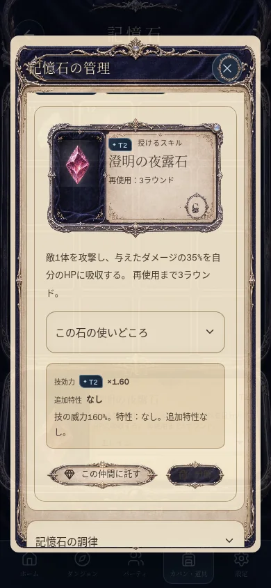
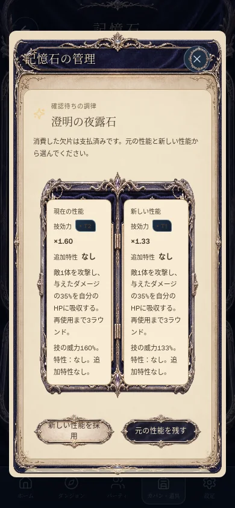
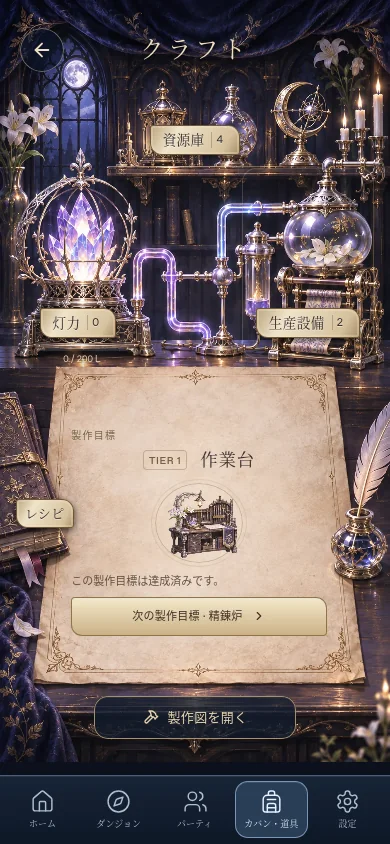
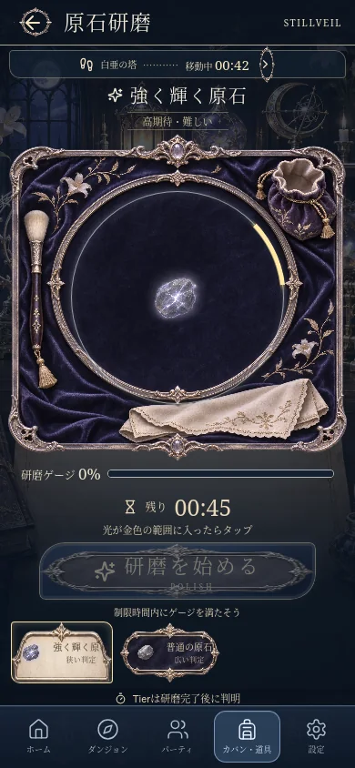
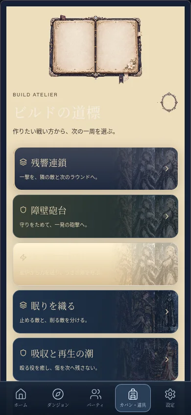
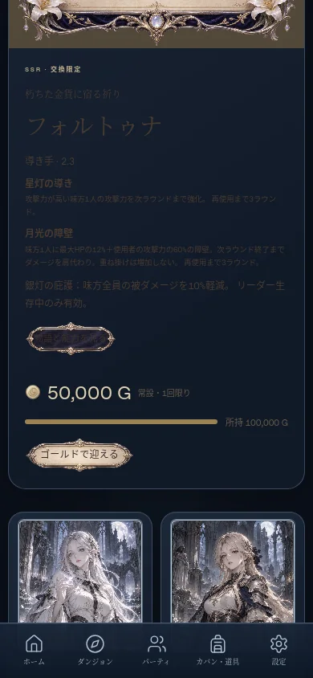

# 所持品の子画面

旅鞄・クラフト机・記憶石収集箱から開く画面を、紺のベルベット・古い銀の飾り枠・生成りの紙面で統一する。画像へ文字や性能を焼き込まず、所持数・性能・製作状態・操作可否は既存の実データから表示する。

## 対象

- 道具と回復薬購入、素材一覧と交換、旅の記録と探索統計。
- 記憶石の検索・絞り込み・装備・保護・移動確認・分解確認・調律の新旧比較・製作・入手先。
- 原石研磨の作業台・原石選択・確定した石の表示。
- クラフトの生産設備・製作図・資源庫・灯力・依存関係。
- ビルド手帳のレシピ・達成状況・適用確認。
- 関連する探索準備、キャラクター詳細、ゴールド交換の購入確認、妖精ガイド。

## 共通部品

`InventoryTheme` と型付きの `Modal.inventoryArt` で色とボタンのテーマを指定する。ポータルにも同じテーマを渡す。`InventoryFrame` は9分割で枠を伸ばし、長い画面でも角の飾りを引き伸ばさない。`InventoryIllustration` と `InventorySprite` は GameImage を通し、操作は親の共通 Button が受け取る。Buttonの既存操作音・コマンド処理は変更しない。

`InventorySection.art` は開いた区画の挿絵を指定するだけで、一覧の初期折りたたみ契約は維持する。画像はWebP、アイテムはアトラスを共有する。背景に動画や常駐アニメーションを追加しない。

紙面には濃い文字、ベルベットのボタンには明るい文字を使う。入力欄は明るい配色で統一。額縁の人物画はcontainで全体を残し、下の札には名前を動的に描く。

## 素材と保存

新規素材は20点（パネル12・アトラス8）、スプライト117枠。全67種のクラフトアイテムをカバーする。素材は `public/art/inventory/`、登録は `src/content/inventory-art.ts`、切り出し座標は `src/content/inventory-sprites.json`。生成時の指示と原画識別子は [素材記録](inventory-child-art-sources.json) に保存する。

保存形式・製作レシピ・戦闘性能・報酬を変更しない。確認画面を閉じても、既存の確認処理以外で装備・購入・調律結果を確定しない。

## 検証

`e2e/inventory-children.spec.ts` は隔離した保存データで素材・石の詳細・実際の調律候補生成と破棄・設備・製作図・旅の記録・ビルド手帳・人物詳細を開き、320/390pxの横はみ出しとフルイラストのcontainを検査する。既存の記憶石・原石研磨・灯力・自動生産・交換購入・ビルド適用・妖精ガイド・操作音・ネイティブ選択保護の検証も使用する。

## 実画面（WebKit）

隔離した検証セーブを使用。320pxの製作図以外は390px。

| 石の詳細 | 調律の比較 | 生産設備 |
| --- | --- | --- |
|  |  |  |

| 原石研磨 | ビルド手帳 | 人物の詳細 |
| --- | --- | --- |
|  |  |  |

[320pxの製作図](images/illustrated-inventory-children/recipes-320.webp) / [旅の記録](images/illustrated-inventory-children/journal-390.webp)

## ビルド手帳と文字の整理

ビルド手帳は[専用の構成へ再設計](build-notebook.md)。一覧と実演を初期折りたたみにし、現在の進捗と次の行動を先に表示する。ビルド部分のボタンは単純な枠へ変更し、古い配色との競合を解消した。旅の記録・欠片・調律のラベルと、クラフトのレシピの配置も調整している。

## 子画面の追加整理

[カバンの子画面のレイアウト整理](inventory-layout-review.md)で、記憶石・クラフト・素材・道具・研磨の操作と文字を追加調整。上記の最初の実装時の画面記録から、ボタン・検索欄・比較欄・各区画の挿絵の扱いを更新している。現在の操作部品は外側の画像枠と分け、基本的に単純な枠で統一する。
