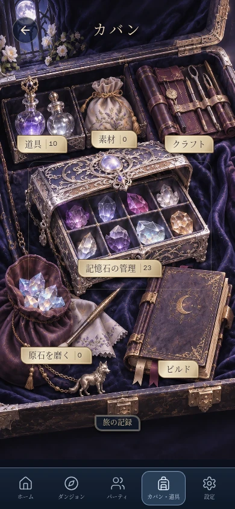
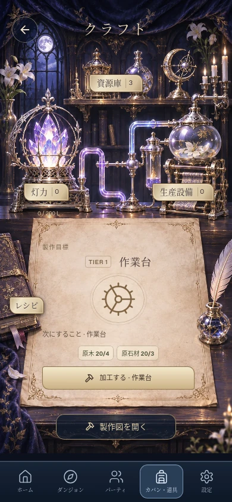
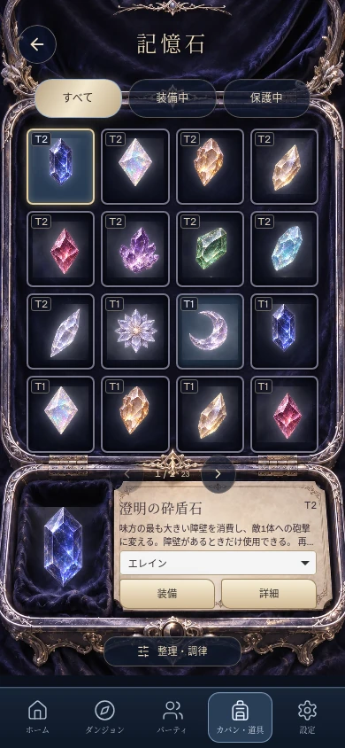

# 旅鞄・クラフト・記憶石収集箱

承認された3画面の見本を元に、カバンの各機能への入口を物の絵へ重ねる。背景と操作を分離し、文字・個数・性能・装備状態は実データを表示する。

- カバン: 薬瓶から道具、素材袋から所持素材と合成、工具からクラフト、中央の収集箱から記憶石、巾着から原石磨き、手帳からビルド。旅の記録には既存の準備ガイド・探索統計・ビルド目標・妖精ガイドをまとめる。0個でも記憶石の入口を表示する。
- クラフト: 旧「旅の工房」の画面名を変更。背景上の灯力装置・生産設備・資源庫・レシピ本を操作する。机の紙には実際の目標Tier、製作対象、材料の所持数/必要数、次にできる行動を表示する。原料不足なら入手先の地図へ移動できる。装置や棚の絵は操作カテゴリを表し、設置済み/所持済みの証拠には使用しない。
- 記憶石: 16枠ずつの収集箱。中身は実在する所持スタックだけ。空き枠は施錠や解放条件と誤解させない無地の枠。Tier、個数、装備中、保護中を動的に表示。選んだ石を検分用の札で確認し、託す仲間を選んで装備できる。同じ性能の予備があれば適切な個体を選ぶ。他の仲間から移す場合は既存の確認手順を通す。
- 整理・調律: 元の検索・系統・用途・変種・並べ替え・装備比較・保護・分解・製作・調律・入手先を共通Modalで開く。長い一覧は共通InventorySectionで初期折りたたみを維持する。収集箱から特定の石の「詳細」を明示的に開いた場合だけ、その石の詳細を展開する。
- 既存の `#bag/workshop[/recipe]` と `#bag/gems[/definition]` を維持し、`#bag/craft[/recipe]` も解釈する。保存形式、レシピ、報酬、戦闘能力は変更しない。

背景は `InventoryScene`、物の操作領域は `InventoryHotspot`、絵は共通GameImage、操作は共通Button、詳細は共通Modalを使用する。画像自体に操作を付けない。アニメ動画・常駐描画ループ・音声処理は追加しない。

## 素材

見本と本実装用の素材はプロジェクト用のAI生成オリジナル。ゲームには文字なし背景をWebPとして配置し、全てcontent.assetsへ登録する。

- `travel-bag`: 旅鞄。元画像 `exec-f53e61c0-f6c4-4fdd-83c1-7b7d8366fae0.png`
- `craft-desk`: 作業机。元画像 `exec-e8764ee2-437d-4ffe-a713-beda59fe4add.png`
- `memory-cabinet`: 空の収集箱。元画像 `exec-abe8a694-a180-4749-ab36-e77d66d869a7.png`
- `memory-gem-atlas`: 12種の独立した宝石画。元画像 `exec-f3a040c9-352c-4d26-8898-fe5b8e064aaa.png`。石の種類で絵柄を選び、性能は絵柄ではなく実Tier/説明で表示する。

検証は `e2e/illustrated-inventory.spec.ts`、既存の記憶石・操作音・クラフト・灯力の回帰検証を使用。スクリーンショット用の所持品は隔離したブラウザ内のfixtureで、公開セーブは変更しない。紹介用の静止画では一時的な獲得通知のみ撮影時のCSSで隠す。

## 実画面（WebKit・390px）

隔離した検証セーブを使用。所持品・灯力・製作状態は実際の保存処理につないだ表示。

| カバン | クラフト | 記憶石 |
| --- | --- | --- |
|  |  |  |
