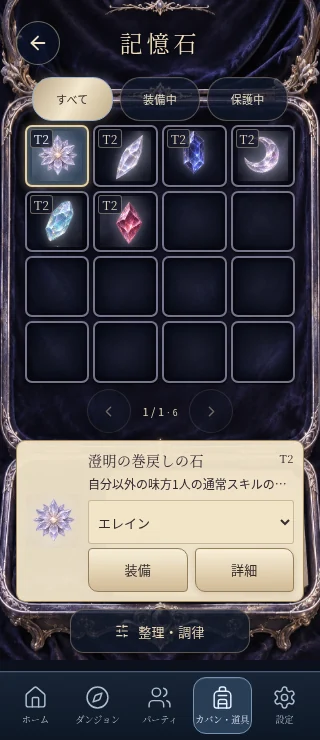
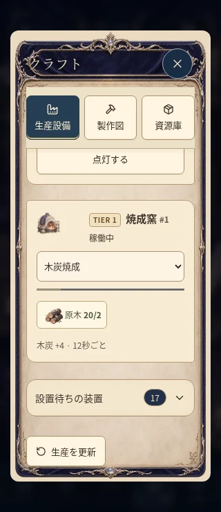
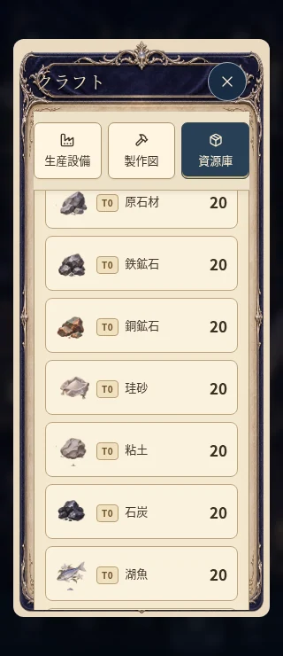
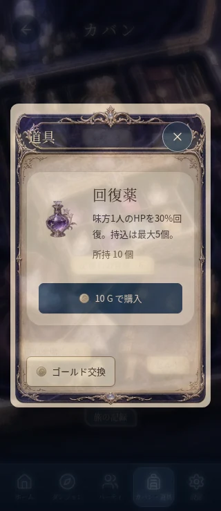
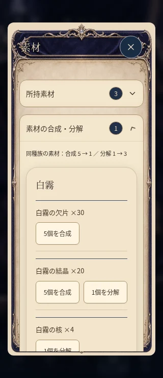
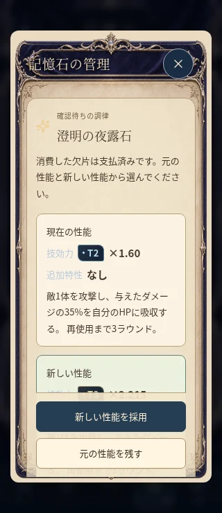

# カバンの子画面のレイアウト整理

額縁や個々の道具の絵は残し、情報を読む面と操作する部分を整理する。ビルド手帳に続き、記憶石・クラフト・道具・素材・旅の記録・原石研磨・交換確認を対象に調整した。

| 画面 | 整理した点 |
| --- | --- |
| 記憶石の収集箱 | 下の札を独立した紙面にし、仲間の選択と装備操作を44px以上へ。ページ送り・札・整理ボタンの重なりを防ぐ。 |
| 記憶石の一覧 | スマホは2列の広いカード。名前と重複する系統・変種の行を取り除き、倍率・特性・装備状態を残す。検索と並び替えを縦に配置。 |
| 石の詳細と調律 | ボタンは単純な枠へ。比較はスマホでは縦並び。効果文と倍率の重複を減らし、数値のある追加特性の説明は残す。調律結果の操作は下部に追従。 |
| クラフト | 生産設備・製作図・資源庫のタブを先頭へ。Tierの絞り込みは製作図にだけ置き、依存関係は折りたたんで下へ。切り替え時は一覧の先頭へ戻す。 |
| 設備・製作図・資源庫 | 絵・名称・状態・材料・操作を別の行へ整理。Tierフィルターはスマホで3列。設備の絵は64px、資源の数量は右端へ。 |
| 道具と素材 | 薬瓶・説明・購入を分け、素材の交換は名前の次に操作を並べる。各区画の空の挿絵を撤去。 |
| 旅の記録 | 空の本を撤去。装備実験・フィルター・集計の紙面に濃い文字を適用。 |
| 原石研磨 | 操作パッドと石の選択を読みやすい配色へ。石の選択札を広げ、下部メニューは共通の単純なアイコンを維持。 |

## 共通の制約

`Modal.inventoryControls` で子画面の操作を指定し、装飾付きの `inventoryArt` を使う場合も中のボタンは標準で `plain` にする。`InventoryTheme.controls` も同じ指定を使う。外枠と中身の読みやすさを分離し、共通Buttonの操作音・GameImageのメディア保護・共通Modalのフォーカスと閉じる動作を保つ。

入力欄の配色は `inventory-controls.css` が所有する。古いCSSとの競合に加え、ネイティブ入力の `-webkit-text-fill-color` も揃える。Tierバッジは紙面の一般的なspanの文字色を継承せず、自分の色を保つ。石とクラフトの配置はそれぞれ `memory-gem-layout.css` と `industry-layout.css` にまとめた。

所持品・製作物・入手先・依存関係の長い区画は引き続き共通InventorySectionで初期折りたたみ。ゲームの保存形式、石の性能、製作や報酬の計算は変更しない。

## 検証

320/390px・日本語と英語で、ボタン・入力・プルダウン・区画見出しの44px以上の操作領域と、横にはみ出さないことを検査する。収集箱ではページ送り・下の札・整理ボタンの重なりを測り、実際のtouchscreen.tapで装備が保存されることを確認する。

本文・数値・カード名・Tier・入力欄を実際のCSS色から検査し、コントラスト比4.5以上を確認する。入力欄は通常のcolorだけでなく実際の文字描画に使われるtext-fill-colorも読む。背景画像の全ピクセルを検査するものではないため、実画面も併せて確認する。

既存の装備移動・保護・分解・製作・調律、灯力と自動生産、原石研磨の成功と期限切れ、交換の確認と取消、単一の操作音、ネイティブ選択と入力の編集の検証を維持する。

## 実画面

隔離した検証セーブを使用。公開セーブは変更していない。

| 収集箱 | 設備 | 資源庫 |
| --- | --- | --- |
|  |  |  |

| 道具 | 素材の交換 | 記憶石の調律 |
| --- | --- | --- |
|  |  |  |

[記憶石の一覧](images/inventory-layout-review/stone-list-320.webp) / [石の詳細](images/inventory-layout-review/stone-detail-320.webp) / [分解の確認](images/inventory-layout-review/salvage-320.webp) / [石の製作](images/inventory-layout-review/stone-crafting-320.webp) / [製作図](images/inventory-layout-review/recipes-320.webp)
