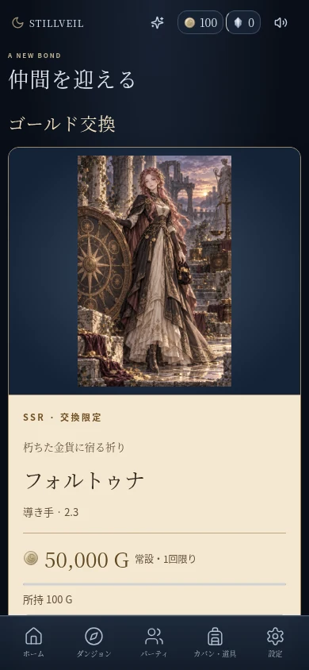
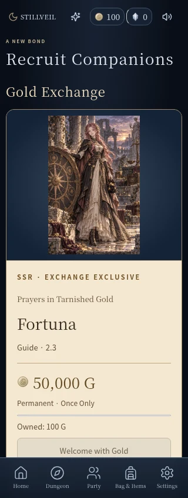

# 仲間を迎える画面の整理

ゴールド交換の全体画に収集用の額縁を重ねていたため、画像の上端と人物の顔が隠れていた。さらに、交換画面専用の文字色と他のテーマの背景指定が競合し、濃い文字が暗い背景へ載ることがあった。

- ゴールド交換の額縁画像と重複した名前札を撤去。フルイラストを専用の紺の展示面へcontainで収め、人物の上に飾りを重ねない。
- 名前・役割・必要ゴールド・所持額・迎える操作を先に表示する。スキルとリーダー効果は共通InventorySectionで初期折りたたみ、物語と能力の詳細も開ける。
- 紺の背景には明るい見出し、生成りの本文には濃い文字を使い、配色と寸法をgold-exchange.cssへ集約する。
- 通常の仲間候補も件数つきの区画へまとめ、スマホでは広い1列のカードにする。狭い画面で隠れていた素材名を戻し、アイコン・名前・所持数/必要数を分けて並べる。

交換価格、購入・取消、重複購入防止、仲間化コストと保存形式は変更しない。

## 検証

ChromiumとWebKitで既存のゴールド交換3件と新規レイアウト/通常仲間化2件を確認。320/390/1024px・日英でイラストの全体表示と無被覆、文字のコントラスト、44px以上の操作、横はみ出しを検査する。通常の仲間化は実際に素材を消費して保存まで確認する。

画面記録は隔離した検証セーブを使用。スキルの開閉やスクロールの後は画面を先頭へ戻し、有限のアニメーションが完了してから撮影する。

| 日本語・390px | 英語・320px |
| --- | --- |
|  |  |

[通常の仲間候補・320px](images/recruit-layout/ordinary-recruit-320.webp)
